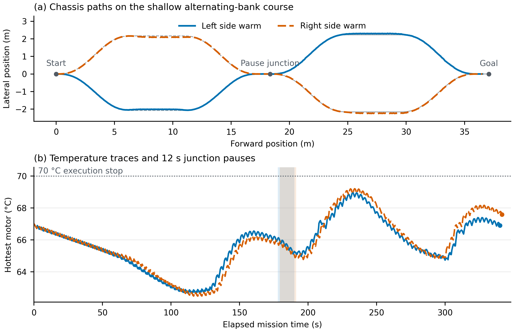

# Thermal Screening of Junction Pauses for Hexapod Route Planning in Simulation

## Abstract

Actuator temperatures can make a planned route infeasible before a legged robot reaches its goal. A pause at a junction can provide time for cooling while the robot supports its weight, but it consumes time and may occur too late to prevent overheating. We evaluate a route-and-speed planner that forecasts all 18 motor temperatures through a 12 s in-place crawl at a junction in MuJoCo. On 72 starts across 12 courses, the per-motor pause planner completed 20 starts, compared with 18 for a fixed reactive planner and 28 for a time-only pause fallback. The per-motor planner and the fixed planner each had zero observed thermal stops, while the time-only fallback had 38. The completion gain over the fixed planner was 2.8 percentage points, below the prespecified 10-point target. Both additional finishes occurred on one shallow alternating-bank course. Reanalysis of the 48 time-only fallback schedules found that 28 thermal stops occurred before the junction and that thermal headroom excluded eight schedules that finished. The results identify when a junction pause can recover a simulated mission and quantify the completion cost of thermal screening.

**Index Terms** · Hexapod robots, legged locomotion, path planning, simulation, thermal management.

## Introduction

A legged robot can have enough time to finish a route and still overheat along the way. At a branching junction, different terrain and speeds can load whichever actuators are already warm. A pause can give warm actuators time to cool before the next branch, but the robot still supports its weight during the pause and consumes part of its deadline. The planner therefore needs to ask whether the robot can reach the junction, cool enough, and finish the remaining route on time.

Prior work used thermal models to regulate climbing speed [1], measured servo temperatures during hexapod rough-terrain trials [2], and adapted quadruped locomotion using simulated motor temperatures [3]. Brodoline et al. measured heat and energy use in a servomotor-based hexapod and reported that the test leg continued drawing power in a static pose [4]. Faigl and Čížek used standing breaks between hardware trials to let actuators cool [2]. These studies motivate an explicit thermal model for a load-bearing pause. [1](https://ieeexplore.ieee.org/document/5152870/) · [2](https://comrob.fel.cvut.cz/papers/ras19adaptive.pdf) · [3](https://arxiv.org/abs/2605.27046v3) · [4](https://www.nature.com/articles/s41598-024-62184-y)

This study evaluates a pause as an action in a route-and-speed graph. We propagate the temperature of each motor through the crawl and pause, then measure the mission outcomes of two ways to decide when to pause. The frozen benchmark asks whether the thermal forecast recovers rejected starts without additional modeled stops. Matched replays isolate the physical effect of adding a pause within the simulator, and a retrospective analysis identifies which admission rule excluded finishable schedules.

## Methods

### Hexapod, terrain and execution

The MuJoCo 3.9.0 model [5] had a floating chassis and three torque-actuated joints per leg at the coxa, femur and tibia. The simplified geometry was informed by the CAD assembly and had a modeled total mass of 82 kg, including the feet. A 3 s crawl gait generated foot targets from the branch centerline and simulated terrain height. Joint position and velocity feedback generated tracking torque. For supporting feet, a regularized least-squares allocation distributed the desired chassis force and moment. The physics step was 2 ms. The simulator recorded body position and contact counts and updated the thermal model every 20 ms using the root-mean-square applied actuator torque from that interval. Each walk began with a 2 s stand. [Robot model](../thermal_pathfinder/model.py) · [Gait controller](../thermal_pathfinder/connected_walk.py) · [Simulation loop](../thermal_pathfinder/walking.py) · [MuJoCo paper](https://ieeexplore.ieee.org/document/6386109/)

The main benchmark used 12 constructed heightfields at a target grid spacing of 0.12 m. Each course contained two stages with two banked branch options per stage and one flat intermediate junction. The goal was 37.08–40.35 m forward from the start, with course deadlines of 342–373 s. Four courses reversed the bank sign for each branch between stages, four kept it, and four had both branches banked in the same direction in at least one stage. Arrival required the chassis to enter a 0.55 m radius around the goal before the deadline and below the 70 °C stop. A fall or chassis contact and lateral error above 0.85 m were additional termination conditions. [Frozen configuration](../experiments/pause_forecast_confirmation.json)

### Thermal dynamics and warm starts

For motor $i$, the thermal state follows a first-order model. For interval $\Delta t$ with actuator root-mean-square torque $q_i$, let $T_{i,\mathrm{eq}}$ be the temperature approached under that constant load. The exact step is

$$
T_{i,\mathrm{eq}} = T_{\mathrm{amb}} + R\left(\frac{q_i}{q_{\mathrm{ref}}}\right)^2 ,
$$

$$
T_i(t+\Delta t) = T_{i,\mathrm{eq}} +
\bigl[T_i(t)-T_{i,\mathrm{eq}}\bigr]\exp(-\Delta t/\tau).
$$

Ambient temperature $T_{\mathrm{amb}}$ was 25 °C and reference torque $q_{\mathrm{ref}}$ was 55 N·m. The confirmation starts used the same three settings as the preceding study. All had a cooling time constant $\tau$ of 120 s. The parameter $R$ is the modeled equilibrium rise above ambient at the reference torque.

| Relative heating rate | Equilibrium rise at reference torque, °C | Warm side, °C | Cool side, °C |
| ---: | ---: | ---: | ---: |
| 0.46 | 33.12 | 67 | 45 |
| 0.44 | 31.68 | 67 | 45 |
| 0.45 | 32.40 | 68 | 48 |

Each course and thermal setting had two starts. All nine motors on one side started at the warm value and the other nine at the cool value. Exchanging the sides preserved the mean and maximum starting temperatures. The simulator began linear torque derating at 67 °C. The model's torque cap reached 75% of nominal at 70 °C, where the simulator stopped the walk. When the hottest motor reached 67 °C, the slowdown controller ramped the reactive cap toward 65% of nominal speed over 2 s and began restoring it when the hottest motor fell to 65.50 °C. The normal command took the lower of the planned speed and this cap. The 12 s pause set the commanded forward speed to zero while the crawl continued. [Thermal update](../thermal_pathfinder/thermal.py) · [Reactive controller](../thermal_pathfinder/speed_policy.py) · [Junction pause](../thermal_pathfinder/junction_pause.py)

### Forecasting a paused schedule

Each stage offered two planned commands, 100% or 65% of the 0.12 m/s nominal speed. The two branches at each of two stages yielded 16 complete route-and-speed combinations per course. Nominal profiling ran each branch at both commands. It grouped the samples by forward position in bins of approximately 0.30 m and estimated forward rate and mean squared torque by motor in each bin. Candidate forecasts interpolated between the two profiled speeds and advanced both position and 18 motor temperatures in 0.50 s increments with the reactive cap active. The branch profiles approximated the loads and progress during warm execution, where applied torque and resulting contact dynamics could differ.

During the forecast pause, planned and reactive speed states continued to update, position stayed fixed, and each motor used an equivalent constant squared torque. For each of eight 12 s windows at one development junction, we used the simulated entry and exit temperatures, $T_{i,\mathrm{in}}$ and $T_{i,\mathrm{out}}$, to estimate the constant squared torque $q_{i,\mathrm{hold}}^2$ for a pause of duration $d$.

$$
q_{i,\mathrm{hold}}^2 =
\frac{q_{\mathrm{ref}}^2}{R}
\left[T_{i,\mathrm{in}}-T_{\mathrm{amb}}+
\frac{T_{i,\mathrm{out}}-T_{i,\mathrm{in}}}{1-\exp(-d/\tau)}\right].
$$

We averaged inferred squared torques within each first-stage speed and then averaged the two speeds equally. The forecast continued with the post-pause temperature vector and speed state. [Forecast code](../thermal_pathfinder/pause_forecast.py) · [Pause development study](junction_pause.md) · [Frozen motor loads](../results/pause_forecast_confirmation/pause_model.json)

### Planning comparisons and analysis

All three planners first searched the no-pause schedules. A candidate qualified if its predicted peak was strictly below 69.50 °C and its finish forecast was within the deadline. Among qualifying schedules, the planner chose the lowest predicted peak, then the earliest predicted finish and the schedule identifier. A fallback ran only on an original planning rejection and shared the same total two-second online budget. Offline nominal profiling was outside that budget. The planners used the same physics controller in execution.

| Planner | Rule after the initial search rejects the start |
| --- | --- |
| Fixed reactive | Record a planning rejection. |
| Time-only pause fallback | Add 12 s to each no-pause time forecast, filter by deadline, then choose the lowest no-pause forecast peak. The forecast peak serves as a ranking criterion. |
| Per-motor pause forecast | Forecast the complete paused schedule, screen with the same 69.50 °C cutoff and deadline, then rank qualifying schedules by predicted peak and finish time. |

The frozen benchmark paired all three planners on 72 starts. Identical schedules selected on the same start shared a deterministic trace. Planning rejections, deadline misses and thermal stops counted in the 72-start denominator. The prespecified comparison required at least a 10-percentage-point gain over the fixed planner, with no additional observed thermal stops. We summarized uncertainty by resampling the 12 courses with replacement and calculating a descriptive 95% percentile interval across 20,000 samples. The separate post hoc screen kept the time-only fallback schedules and their outcomes fixed while recomputing whether each candidate would pass the complete paused forecast. [Locked comparison](../results/pause_forecast_confirmation/confirmation_lock.json) · [Per-course audit](../results/pause_forecast_confirmation/confirmation_audit.json) · [Screening diagnostic code](../thermal_pathfinder/pause_screening_diagnostic.py)

## Results

### Mechanism and development

In the initial 36-start comparison, a planner with labeled starting temperatures completed 32 missions and a planner that averaged over the two possible warm-side assignments completed 31. A supplemental bank-order comparison held geometry, deadlines and initial temperature values fixed within each matched pair. Reversing the stages changed whether the per-motor planner completed the walk in three comparisons, all with the right-side motors warm. The 13/24 versus 7/24 completion result in that supplement applies to two simulated heating settings chosen after an earlier all-rejection run. [Motor identity comparison](mission_completion.md) · [Bank-order comparison](matched_load_order.md)

The first pause trial expanded the action set on an unequal-banks start that overheated under all 16 original route-and-speed schedules. A 12 s in-place crawl yielded one finish at 350.32 s, with a 69.91 °C peak and a 352 s deadline. The same schedule with a 6 s pause overheated and with a 24 s pause missed the deadline. On four other courses, executing identical schedules with a 12 s pause increased completion from four to seven of 22 matched schedules. All three gains were on the crossed split. [Pause development trial](junction_pause.md) · [Matched pause transfer](junction_pause_transfer.md)

On seven completed archived paused walks, the mean absolute forecast error was 0.092 °C for the mission peak and 1.56 s for finish time. When the model received the measured entry temperatures at the junction, mean absolute error across motors at the end of the pause was 0.030 °C. [Archived forecast results](pause_forecast.md)

### Frozen comparison on 12 courses

The larger benchmark included 72 paired starts. Each course contributed two assignments of the same starting temperatures under each of three simulated thermal settings. The comparison retained the 12 s pause, 69.50 °C planning cutoff, 70 °C execution stop and two-second online planning budget. Each fallback preserved the fixed planner's original admissions. On a rejected start, the time-only fallback selected a paused schedule by allocating 12 additional seconds and ranking candidates by the original forecast peak. The per-motor fallback recomputed the entire paused temperature and time trajectory and enforced both admission gates.

| Planner | Completed | Planning rejection | Thermal stop | Deadline miss |
| --- | ---: | ---: | ---: | ---: |
| Fixed reactive | 18 | 50 | 0 | 4 |
| Time-only pause fallback | 28 | 2 | 38 | 4 |
| Per-motor pause forecast | 20 | 48 | 0 | 4 |

The per-motor fallback recovered two of the fixed planner's rejected starts and preserved its 18 finishes. The 2.8-percentage-point improvement fell short of the 10-point criterion. The descriptive 95% interval from resampling courses was 0.0 to 8.3 points. Both additions occurred in the near-boundary thermal setting on the shallow alternating-bank course, one for each warm-side assignment. The left-warm and right-warm walks respectively finished in 340.02 s and 341.44 s against a 342 s deadline. Peak temperatures were 68.96 °C and 69.21 °C. All 216 planning decisions were within budget. [Full course and thermal-setting breakdown](pause_forecast_confirmation.md)

Figure 1 shows the two additional finishes. Exchanging which side started warm reversed the selected branch on each stage. The shaded bands mark when the feet continued cycling with a zero forward speed command.

**Fig. 1.** Chassis position and maximum motor temperature for the two additional completions. The upper panel shows branch centerlines in gray and the simulated chassis traces in blue and orange. The lower panel marks each 12 s pause with a shade matching its trace. Dots at the ends mark mission completion. [Vector figure](figures/junction_paths_and_temperatures.svg)

### Screening errors and pause reachability

In a post hoc analysis, we recomputed the full paused forecast for the 48 time-only fallback schedules while holding the schedule and execution trace fixed. All 48 had paused finish forecasts within their course deadlines. At the 69.50 °C cutoff, 38 of the schedules that failed the thermal gate hit the modeled execution stop and nine finished. One finish passed the thermal gate. The per-motor planner selected different paused schedules for its two additional completions. The time-only fallback also finished both starts.

The eight starts that only the time-only planner completed had forecasts from 69.504 to 69.882 °C. All eight fit both the simulated 70 °C limit and the predicted deadline, and all eight failed the inherited 0.50 °C admission margin. Among the 48 fixed candidates, a hypothetical screen using 70 °C would admit ten observed finishes and one observed thermal stop. This replay analysis tests admission on fixed candidates. It leaves the results of applying a new cutoff during route selection undetermined. Of the 38 thermal stops, 28 occurred before the junction at which the pause could activate. [Screening analysis and replay references](../results/pause_forecast_confirmation/screening_diagnostic.json)

Figure 2 shows the benchmark outcomes and plots the retrospectively scored time-only schedules against both admission variables. Positive predicted time to spare means the elapsed-time forecast fit the deadline.

**Fig. 2.** Planner outcomes over 72 starts and the 48 attempted time-only pause schedules. The right panel shows plotted forecasts and observed outcomes. The shaded region spans the 69.50 °C planning cutoff (dashed) to the 70 °C execution stop (dotted). [Vector figure](figures/benchmark_outcomes_and_screening.svg)

## Discussion

The experiment distinguishes the effect of making a pause available from the effect of screening when to use it. Matched replays showed that the pause changed an overheating walk into a finish on some starts. The larger planner comparison recovered two starts while screening out all 38 overheating schedules attempted by the time-only fallback. It also gave up eight time-only finishes. Those completions and stops quantify the consequences of the admission rule more directly than a change in average motor temperature. The distribution of first-stop locations further explains why allowing time for a pause alone is insufficient. A schedule must survive far enough to reach the junction. [Matched pause transfer](junction_pause_transfer.md) · [Frozen 12-course comparison](pause_forecast_confirmation.md)

The exhaustive replays reveal a pair of cases that shared admission thresholds cannot separate. In the exhaustive schedule audit, the only finishable schedule on the left-warm crossed split had 0.135 °C and 4.69 s of predicted headroom. A schedule on left-warm unequal banks had more headroom on both measures, 0.185 °C and 13.81 s, yet it overheated. Every tested schedule on that unequal-banks start overheated. A shared pair of minimum headroom requirements that admits the crossed-split finish also admits at least one overheating schedule on unequal banks. This counterexample applies to these candidate sets and forecasts. [Exhaustive schedule audit](schedule_audit.md)

## Limitations

The hexapod simulations used assumed actuator thermal parameters and known initial per-motor temperatures. The 12 courses were hand designed with the same two-stage graph structure. Repeated starts on a course share its geometry, so intervals resample courses and describe variation across the benchmark. The pause load estimate came from one development junction and approximates the torque history during the crawl with constant effective loads. The planner could schedule one fixed-duration pause at the first junction and its fallback ran only after a planning rejection. The results describe simulated choices and stops under that controller, schedule set, and thermal model. [Model assumptions and protocol](protocol.md) · [Frozen 12-course design](pause_forecast_confirmation.md)

## Conclusion

Forecasting a 12 s junction pause recovered two starts across the 12-course simulation benchmark, with both gains concentrated on one shallow alternating-bank course. The 2.8-percentage-point improvement fell below the prespecified completion target. Thermal screening reduced observed stops from 38 to zero relative to the time-only fallback and reduced completions from 28 to 20. An investigation of the fixed replay schedules showed that most stops occurred before the junction and that the inherited margin rejected eight otherwise finishable starts. Under these conditions, a junction pause can recover individual missions while the forecast margin governs which walks the planner attempts.

## Data and reproducibility

The project records the course configurations and archived model, the 216 planning decisions, the 72 distinct warm replays and their checksums, and the retrospective screen. The figure generator reads those saved records. The reproduction commands are in the repository README. [Experiment configuration](../experiments/pause_forecast_confirmation.json) · [Reproduction commands](../README.md) · [Figure generator](../thermal_pathfinder/manuscript_figures.py)

## Acknowledgment draft

OpenAI Codex assisted with drafting and editing the manuscript, implementing simulation and analysis scripts, and preparing figures. The reported numerical results and plots were checked against archived simulation records. [IEEE Access guidance on AI disclosure](https://ieeeaccess.ieee.org/authors/preparing-your-article/)

## References

1. S. Trujillo and M. Cutkosky, “Thermally constrained motor operation for a climbing robot,” *IEEE International Conference on Robotics and Automation*, 2009. [DOI](https://doi.org/10.1109/ROBOT.2009.5152870)
2. J. Faigl and P. Čížek, “Adaptive locomotion control of hexapod walking robot for traversing rough terrains with position feedback only,” *Robotics and Autonomous Systems*, vol. 116, pp. 136–147, 2019. [DOI](https://doi.org/10.1016/j.robot.2019.03.008)
3. Y. Wan et al., “Learning to balance motor thermal safety and quadrupedal locomotion performance with residual policy,” arXiv:2605.27046v3, 2026. [Preprint](https://arxiv.org/abs/2605.27046v3)
4. I. Brodoline, E. Sauvageot, S. Viollet, and J. R. Serres, “Shaping the energy curves of a servomotor-based hexapod robot,” *Scientific Reports*, vol. 14, art. 11675, 2024. [DOI](https://doi.org/10.1038/s41598-024-62184-y)
5. E. Todorov, T. Erez, and Y. Tassa, “MuJoCo: A physics engine for model-based control,” *IEEE/RSJ International Conference on Intelligent Robots and Systems*, 2012. [DOI](https://doi.org/10.1109/IROS.2012.6386109)
