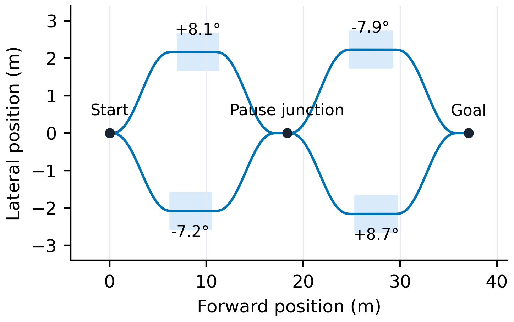
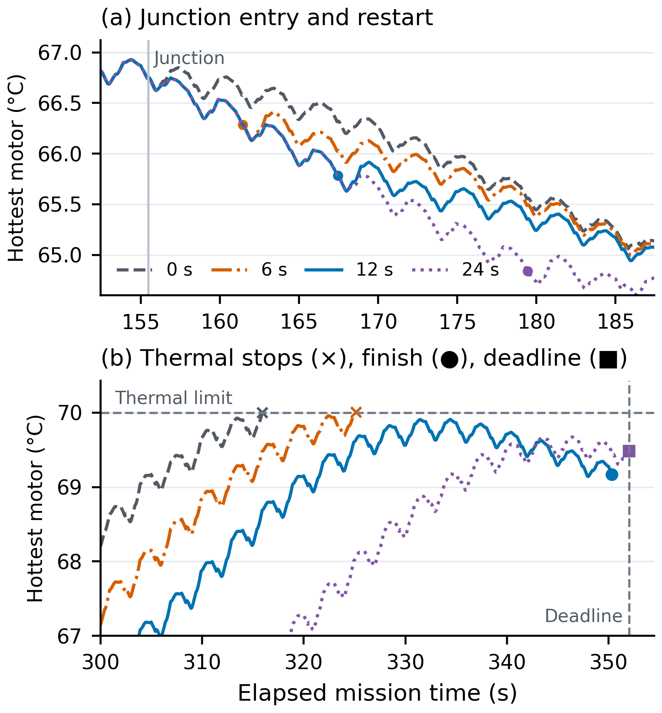
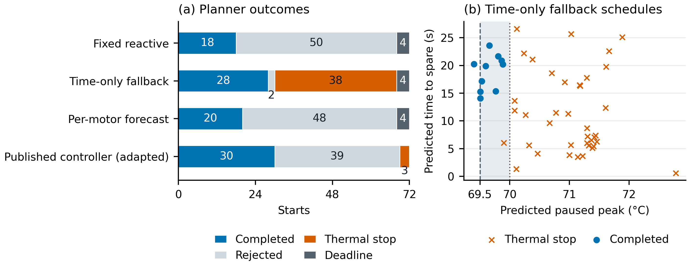
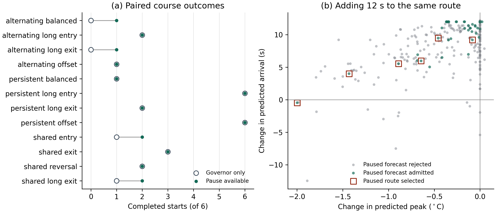

# Thermal Screening of Junction Pauses for Hexapod Route Planning in Simulation

## Abstract

We evaluated a 12 s load-bearing junction pause for thermal route planning in an 18-motor MuJoCo hexapod. In the first 72-start benchmark, a per-motor pause forecaster completed 20 missions, compared with 18 for a fixed reactive planner and 28 for a time-only pause fallback. The per-motor and fixed planners recorded zero thermal stops. The time-only fallback recorded 38, including 28 before the junction. An adaptation of a published thermal speed controller completed 30 missions with three thermal stops on the same starts. A second 72-start benchmark on new courses held that controller and the route-ranking rule constant. Enabling the pause raised completion from 25 to 29 and thermal stops from two to four. Same-route replays confirmed three recoveries from thermal stops. The fourth added mission finished at both pause durations in the diagnostic replays. The completion gains of 2.8 and 5.6 percentage points fell below the prespecified 10-point target.

**Index Terms** · Hexapod robots, legged locomotion, path planning, simulation, thermal management.

## Introduction

A legged robot in this study must reach the goal by a mission deadline and keep each actuator below the modeled thermal limit. The planner chooses branches and speed commands using the individual starting temperatures. It also evaluates a 12 s zero-forward-speed crawl at the intermediate junction. The feet continue cycling during the pause, and the pause counts toward the deadline.

Prior work used thermal models to regulate climbing speed [1], measured servo temperatures during hexapod rough-terrain trials [2], and trained a quadruped locomotion controller conditioned on modeled motor temperatures [3]. Brodoline et al. measured heat and energy use in a servomotor-based hexapod and reported that the test leg continued drawing power in a static pose [4]. Faigl and Čížek used standing breaks between hardware trials to let actuators cool [2]. These studies motivate an explicit thermal model for a load-bearing pause. [1](https://ieeexplore.ieee.org/document/5152870/) · [2](https://comrob.fel.cvut.cz/papers/ras19adaptive.pdf) · [3](https://arxiv.org/abs/2605.27046v3) · [4](https://www.nature.com/articles/s41598-024-62184-y)

The controller budgets heat for individual motors. Its squared-torque budget equation makes each budget a function of the corresponding motor temperature, so exchanging the warm and cool sides exchanges their budgets at fixed branch and time while preserving mean and maximum temperature. The stage-order experiment uses the same two stage geometries in opposite order.

We study a single load-bearing pause on a two-stage graph. The first question is whether the action changes feasibility for a fixed route and speed schedule. The second is whether a planner can select useful pauses in advance while avoiding modeled thermal stops. We answer the first using matched physics replays and the second using a frozen 12-course benchmark. A supplementary comparison applies a published thermal speed rule to the same courses. A separate test on 12 fresh courses then adds a pause option to the same published speed governor. The fixed-candidate analysis counts thermal stops by junction reachability and reports replay outcomes at two forecast cutoffs.

## Methods

### Routing problem and course design

Each course is a directed graph with start $S$, flat junction $J$, and goal $G$. Two branches connect $S$ to $J$ and two connect $J$ to $G$. At $J$, the chassis can continue or perform an in-place crawl of duration $d$. A candidate schedule is $(e_1,e_2,u_1,u_2,d)$, where $e_k$ denotes the branch at stage $k$ and $u_k$ is the stage speed command or a shared feedback law. Execution runs the branch pair on one continuous MuJoCo scene and carries foot, chassis, controller, and motor states across the junction.

Feasible execution requires entry into the goal region by the deadline $D$, with every sampled $T_i$ strictly below $T_\mathrm{lim}$. The simulation also checks falls, chassis contact, and corridor departures. The planner evaluates the forecast peak $\widehat T_{\max}$ and finish time $\widehat t_f$. Thermal headroom $T_\mathrm{lim}-\widehat T_{\max}$ must exceed 0.50 °C for a thermally screened candidate. Deadline headroom $D-\widehat t_f$ must be nonnegative.

**Fig. 1.** The shallow alternating-bank course. Shading marks the nominal bank sections. Each stage selects one branch. The optional 12 s pause is available at the shared flat junction.

Each stage has smooth approach and exit curves that connect the flat landings to its two offset centerlines. Bank profiles fade in and out along each branch. We varied the approach and exit length, bank length, lateral offset, bank angle, and longitudinal bank shift. Alternating courses reverse the bank signs between stages and persistent courses retain them. The third family has two branches with the same sign in at least one stage. These signs describe geometry. Motor heating comes from the crawler dynamics.

### Hexapod and physics execution

The simulation used MuJoCo 3.9.0 [5]. The hexapod had a floating chassis and three torque-actuated joints per leg at the coxa, femur and tibia. The simplified geometry was informed by the CAD assembly and had a modeled total mass of 82 kg, including the feet. From proximal to distal, the segment lengths were 0.157, 0.550, and 0.740 m, and the nominal joint torque limits were 90, 150, and 130 N·m. A 3 s crawl gait generated foot targets from the branch centerline and simulated terrain height. Joint position and velocity feedback generated tracking torque. For supporting feet, a regularized least-squares allocation distributed the desired chassis force and moment. The physics step was 2 ms. The simulator recorded body position and contact counts and updated the thermal model every 20 ms using the root-mean-square applied actuator torque from that interval. Each walk began with a 2 s stand. · [MuJoCo paper](https://ieeexplore.ieee.org/document/6386109/)

The 3 s gait staggers foot phases by 0.50 s. Each foot swings for 13.5% of a cycle, with a 0.09 m lift at mid-swing. The controller sets touchdown from the centerline pose and terrain height ahead of the body. When at least three feet meet the stance-support test, the force allocator distributes the commanded six-dimensional body wrench across them. The unconstrained force allocation is $\mathbf f=\mathbf A^\mathsf T(\mathbf A\mathbf A^\mathsf T+0.02\mathbf I)^{-1}\mathbf w$ for support matrix $\mathbf A$ and body wrench $\mathbf w$. Vertical forces are clamped to be nonnegative and horizontal magnitudes are capped at 0.65 times vertical force. Foot Jacobians map the force requests to joint torque terms.

The 12 constructed heightfields used a target grid spacing of 0.12 m, with four courses per family. Goals were 37.08–40.35 m forward of the start, with deadlines of 342–373 s. The chassis had to enter a 0.55 m goal radius while its lateral error to the selected centerline stayed at or below 0.85 m. The thermal stop check precedes the goal check within each 20 ms sample. The deadline includes both the initial stand and the crawl.

### Thermal dynamics and warm starts

The simulator tracks and independently updates one temperature for each of 18 motors. For a 20 ms sample containing $n=10$ physics steps, the actuator RMS torque is $q_i=(n^{-1}\sum_j M_{ij}^2)^{1/2}$, for applied torque $M_{ij}$ at step $j$. For interval $\Delta t$, let $T_{i,\mathrm{eq}}$ be the temperature approached under this load. The equilibrium and exact update are

$$
T_{i,\mathrm{eq}} = T_{\mathrm{amb}} + R\left(\frac{q_i}{q_{\mathrm{ref}}}\right)^2 ,
$$

$$
T_i(t+\Delta t) = T_{i,\mathrm{eq}} +
\bigl[T_i(t)-T_{i,\mathrm{eq}}\bigr]\exp(-\Delta t/\tau).
$$

Ambient temperature $T_{\mathrm{amb}}$ was 25 °C and reference torque $q_{\mathrm{ref}}$ was 55 N·m. Both 72-start benchmarks used the three simulated settings in the table. All had a cooling time constant $\tau$ of 120 s. The parameter $R$ is the modeled equilibrium rise above ambient at the reference torque. At heating multiplier $m$, $R=72m$ °C.

| Relative heating multiplier | Equilibrium rise at reference torque, °C | Warm side, °C | Cool side, °C |
| ---: | ---: | ---: | ---: |
| 0.46 | 33.12 | 67 | 45 |
| 0.44 | 31.68 | 67 | 45 |
| 0.45 | 32.40 | 68 | 48 |

For each course and thermal setting, one start assigned all nine motors on the left side the warm value and the others the cool value. The second start reversed the sides. Exchanging the sides preserves the mean, maximum, and full unlabeled distribution of starting temperatures while changing which motors have each value.

All controllers share linear per-motor torque derating from 67 °C to 75% of the nominal cap at 70 °C, when the simulator stops. The three frozen-benchmark planners also use a reactive speed rule. At 67 °C the hottest motor triggers a 2 s ramp of the speed cap toward 65%. The cap begins returning to nominal at or below 65.50 °C. The default forward command is the lesser of planned speed and this cap. A pause overrides that command with zero forward speed and leaves the crawl phase active. The physics replay leaves chassis position unconstrained during the pause.

### Branch profiles and route forecast

The two planned commands are 100% and 65% of the 0.12 m/s nominal speed. Two branches and two commands at each stage yield 16 complete schedules. We profiled branches offline in nominal physics at each command, with no thermal derating. We grouped samples after the stand into equal-width forward-position bins of width $\Delta x$ close to 0.30 m. A bin with $n_b$ samples has forward-rate estimate $\Delta x/(0.02 n_b)$ in meters per second. The motor load estimate is the mean of the $n_b$ squared RMS torque samples. The separate stand trace for the first command initializes the prediction. The final bin also supplies the short flat approach from the profile stopping point to the intermediate junction.

Let $\alpha=(u-0.65)/0.35$ for command $u$ as a fraction of nominal speed. Each prediction linearly interpolates forward rate and every motor's mean squared torque in the current bin. For motor $i$ the interpolated load is $L_{b,i}=(1-\alpha)L_{b,i,\mathrm{slow}}+\alpha L_{b,i,\mathrm{fast}}$. The forecast advances forward progress and motor temperatures in 0.50 s steps and clips its last step at the forward goal approximation $x_G-0.55$ m. After junction crossing, the planned stage command slews at 0.5 of nominal speed per second. The forecast also updates the thermal slowdown state. Nominal profiles use unmodified torque limits. Warm replays apply temperature-dependent torque clipping and carry the locomotion state across the junction.

### Forecasting the load-bearing pause

During the forecast pause, planned and reactive speed states continued to update, position stayed fixed, and each motor used an equivalent constant squared torque. For each of eight recorded 12 s pause windows on one development approach, four per approach speed, we used the simulated entry and exit temperatures, $T_{i,\mathrm{in}}$ and $T_{i,\mathrm{out}}$, to estimate the constant squared torque $q_{i,\mathrm{hold}}^2$ for a pause of duration $d$.

$$
q_{i,\mathrm{hold}}^2 =
\frac{q_{\mathrm{ref}}^2}{R}
\left[T_{i,\mathrm{in}}-T_{\mathrm{amb}}+
\frac{T_{i,\mathrm{out}}-T_{i,\mathrm{in}}}{1-\exp(-d/\tau)}\right].
$$

We averaged inferred squared torques within each first-stage command and then averaged the two commands equally. Paused forecasts in both 72-start benchmarks used the same fitted loads. A motor cools during the modeled hold when its entry temperature exceeds the hold-load equilibrium. Forward progress resumes with the evolved temperature vector and current speed state, and the forecast peak includes the stand, both stages, and the pause.

Fitted squared torque during the 12 s hold, in (N·m)².

| Leg | Coxa | Femur | Tibia |
| --- | ---: | ---: | ---: |
| Left front | 5.943 | 2904.157 | 28.293 |
| Left middle | 3.320 | 3758.819 | 34.013 |
| Left rear | 1.669 | 2809.037 | 27.238 |
| Right front | 2.627 | 3030.600 | 29.827 |
| Right middle | 1.695 | 3578.708 | 34.374 |
| Right rear | 2.913 | 2911.345 | 29.891 |

### Planning comparisons and analysis

All three planners first searched the no-pause schedules. A candidate qualified if its predicted peak was strictly below 69.50 °C and its finish forecast was within the deadline. Among qualifying schedules, the planner chose the lowest predicted peak, then the earliest predicted finish and the schedule identifier. A fallback ran only on an original planning rejection and shared the same total two-second online budget. Offline nominal profiling was outside that budget. The planners used the same physics controller in execution.

| Planner | Rule after the initial search rejects the start |
| --- | --- |
| Fixed reactive | Record a planning rejection. |
| Time-only pause fallback | Add 12 s to the no-pause arrival forecast and filter by deadline. Rank by no-pause peak, predicted arrival, and schedule identifier. The fallback applies no thermal admission cutoff. |
| Per-motor pause forecast | Forecast the complete paused schedule, screen with the same 69.50 °C cutoff and deadline, then rank qualifying schedules by predicted peak and finish time. |

The locked comparison required complete nominal runs at both speeds for each candidate branch. The three planners were paired on 72 starts. Identical schedules, including pause duration, shared deterministic physics traces.

Let $Y^{(m)}_{cj}$ equal 1 for a mission completion under method $m$ on start $j$ of course $c$, and 0 for all rejection and failure outcomes. The primary effect is the difference in course-mean completion when switching from fixed planner $F$ to pause planner $P$.

$$
\widehat\Delta_{P,F}=\frac{100}{12}\sum_{c=1}^{12}\frac{1}{6}
\sum_{j=1}^{6}(Y^{(P)}_{cj}-Y^{(F)}_{cj}) .
$$

The prespecified criterion was at least 10 percentage points and no added observed thermal stops. It required eight net added finishes. We recomputed the complete paused forecasts for the 48 schedules selected after initial rejection by the time-only fallback. We applied cutoffs of 69.50 and 70.00 degrees Celsius to the same forecasts and counted admissions by the observed replay outcome. We also recorded the junction reachability of each stopped run.

### Comparison with a published speed controller

Trujillo and Cutkosky [1, Sec. III-D, Eq. 8] used measured motor case temperature and a winding temperature limit to bound average heating over the upcoming gait period. At each footfall they inverted an empirical heating-versus-speed curve for the four-legged RiSE climber. We apply the fastest-feasible-speed rule to the 18 simulated motors using the first-order model and the hexapod’s position-dependent branch profiles.

Setting $T_i(t+g)=T_\mathrm{cap}$ in the thermal step gives the squared-torque budget for gait period $g=3$ s.

$$
B_i=\frac{q_\mathrm{ref}^2}{R}\left[T_i-T_\mathrm{amb}+
\frac{T_\mathrm{cap}-T_i}{1-\exp(-g/\tau)}\right].
$$

Every 0.50 s, the regulator chooses the largest $\alpha\in[0,1]$ for which $L_{b,i}(\alpha)\leq B_i$ for all motors. An increasing load with speed supplies an upper bound, a decreasing load supplies a lower bound, and a constant load must independently satisfy its budget. If the bounds have no common solution, the controller logs the infeasible update and commands the 65% endpoint. The common torque derating and 70 °C execution stop remain active. The heat budget serves in place of the hysteretic speed cap.

A route-selection wrapper forecasts the controller on the four geometric routes. It selects the earliest predicted arrival within the deadline and with a forecast peak below 69.50 °C, breaking ties by peak and route identifier. The wrapper and thermal parameters belong to the simulated hexapod. The supplementary comparison added the rule after the frozen benchmark and reused the same 72 starts without fitting to their warm replay outcomes. It changes the feedback rule and route ranking as well as pause availability and compares the complete strategies.

### Matched test of pause availability

The published-controller comparison changes both speed regulation and route ranking relative to the fixed reactive planner. We therefore ran a second experiment in which both arms use the adapted speed governor and the same earliest-arrival ranking. The control evaluates each supported route without a pause. The treatment evaluates the same candidates and also evaluates each route with a 12 s pause at the flat junction. Both admit candidates that arrive by the deadline and have a forecast peak below 69.50 °C. They rank qualifying candidates by predicted arrival, predicted peak, route identifier and pause duration in that order. An exact tie on the same route favors zero pause. Each arm has 2 s of online planning time, including the shared zero-pause forecasts.

The test used 12 fresh courses with the same two-stage graph. Each terrain family contributed four courses. Projected lengths ranged from 37.44 to 40.29 m. We set the deadlines by dividing each projected length by 0.108 m/s and rounding to a whole second. The rate of 0.108 m/s is the median of the ratios of projected length to deadline in the first benchmark, rounded to three decimals. We fixed course geometries and deadlines before running the new profiles and used the same six warm starts on every course. We collected 96 nominal profiles at the two reference speeds. A branch was eligible for either arm if both nominal runs completed. The adapted governor and thermal settings matched those in the supplementary controller comparison.

Zero-pause options use the original governor forecast and execution callback. For paused options, the forecast holds longitudinal position for 24 steps and evolves all motor temperatures under the fitted hold loads in the table. The governor clock continues to advance. In MuJoCo the gait continues cycling with a zero forward command for 12 s. We recorded simulated chassis displacement and the forecast and simulated temperatures at pause entry and exit.

The primary outcome is deadline-constrained completion without a thermal stop, with all 72 paired starts in the denominator. The locked practical benchmark requires at least a 10-percentage-point gain with zero additional thermal stops. We count planning rejections, thermal stops, deadline misses and junction arrivals. We also distinguish starts with an admissible paused option from starts selected for a pause. For every selected paused route, we replay the same route and warm start with zero pause and compare the trajectory prefixes through the last complete sample before pausing. Identical schedules on the same start share one physics replay.

## Results

### Mechanism and development

In the initial 36-start comparison, a planner with labeled starting temperatures finished 32 missions and a planner averaging over the two possible warm-side assignments finished 31. A supplemental bank-order comparison placed the same two stage geometries in opposite order and held the deadlines and initial temperature vectors fixed within each pair. The initial thermal settings produced no admissions. Follow-up settings selected nearer the admission boundary yielded 13 of 24 completions with labels and seven with the anonymous planner. Reversing the stages changed completion for the labeled planner in three comparisons, all with the right side warm.

The pilot tested 6, 12, and 24 s pauses on a left-warm unequal-banks case for which all 16 original schedules overheated. Eight original controls stopped before reaching the junction. The other eight schedules received continuous physics replays at all three durations, and the hottest temperature fell during all 24 of their pauses. The zero-pause control for the only finishable schedule reproduced the original torque, position, contact-count, and temperature arrays.

For that schedule (Fig. 2), a 12 s pause cooled the hottest entry motor from 66.75 to 65.79 °C. The body stayed within 6.83 cm of its pause-entry position. The mission finished in 350.32 s with a 69.91 °C peak and a 352 s deadline. The 6 s replay overheated at 325.16 s, and the 24 s replay reached the deadline below the thermal limit. Among the four durations tested, only the 12 s replay finished by the deadline.

**Fig. 2.** Hottest-motor traces for four pause durations on one unequal-banks schedule. The upper panel focuses on junction arrival and restart. Each trace ends at its first simulated stop or at the goal.

Outcomes for all 16 unequal-banks schedules. The counts at positive durations include eight approach-stage stops.

| Pause (s) | Finished | Thermal stop | Deadline miss |
| ---: | ---: | ---: | ---: |
| 0 | 0 | 16 | 0 |
| 6 | 0 | 15 | 1 |
| 12 | 1 | 14 | 1 |
| 24 | 0 | 14 | 2 |

On four other courses, executing identical schedules with a 12 s pause increased completion from four to seven of 22 pairs. The traces agreed sample by sample before the pause, or through termination if they did not reach the junction. All gains came on crossed split and recovered thermal stops. All four control finishes also finished with a pause. Six pairs stopped before the junction. On the 16 that reached it, the hottest motor cooled by 0.85–1.28 °C during the pause.

| Forecast mean absolute error on archived walks | Walks | Error |
| --- | ---: | ---: |
| Mission peak, full forecast | 7 | 0.092 °C |
| Finish, full forecast | 7 | 1.56 s |
| Finish, nominal time plus 12 s | 7 | 1.75 s |
| Maximum at pause exit, full forecast | 16 | 0.195 °C |
| Pause-exit motor, simulated entry | 16 | 0.030 °C |

The full forecast starts at departure. The separate hold calculation starts from the simulated junction-entry temperatures. The complete pause forecast screened all 15 observed thermal stops and admitted four of seven finishes at 69.50 °C. The three excluded finishes had forecasts of 69.60–69.87 °C. The larger benchmark retained the inherited cutoff.

### Frozen comparison on 12 courses

All 96 nominal profiles completed. The three frozen planners generated 216 decisions for 72 paired starts and selected 72 distinct warm replays. A verification pass checked decision coverage and every warm replay. The longest decision took 0.169 s against a 2 s budget. The table includes the frozen outcomes and the subsequent comparison to the adapted speed rule.

| Planner | Completed | Planning rejection | Thermal stop | Deadline miss |
| --- | ---: | ---: | ---: | ---: |
| Fixed reactive | 18 | 50 | 0 | 4 |
| Time-only pause fallback | 28 | 2 | 38 | 4 |
| Per-motor pause forecast | 20 | 48 | 0 | 4 |
| Published speed rule (adapted) | 30 | 39 | 3 | 0 |

The per-motor fallback recovered two fixed-planner rejections and preserved its 18 finishes. The gain was 2.8 percentage points, below the 10-point target. The forecaster lost eight finishes and reduced thermal stops by 38 relative to the time-only fallback, for a paired completion difference of −11.1 points.

| Family | Course | Goal x (m) | Deadline (s) | Fixed | Time-only | Per-motor | Adapted |
| --- | --- | ---: | ---: | ---: | ---: | ---: | ---: |
| Alternating | Shallow | 37.08 | 342 | 0 | 2 | 2 | 0 |
| Alternating | Early | 38.29 | 352 | 1 | 2 | 1 | 1 |
| Alternating | Long second | 39.41 | 369 | 1 | 2 | 1 | 1 |
| Alternating | Long first | 39.03 | 366 | 0 | 2 | 0 | 2 |
| Persistent | Shallow | 37.24 | 344 | 4 | 4 | 4 | 6 |
| Persistent | Offset | 38.00 | 350 | 0 | 0 | 0 | 2 |
| Persistent | Long second | 40.04 | 371 | 4 | 5 | 4 | 6 |
| Persistent | Long first | 39.38 | 370 | 0 | 1 | 0 | 2 |
| Same-sign stage | First | 37.85 | 348 | 2 | 3 | 2 | 4 |
| Same-sign stage | Second | 38.77 | 356 | 1 | 1 | 1 | 1 |
| Same-sign stage | Reversal | 39.08 | 363 | 2 | 2 | 2 | 2 |
| Same-sign stage | Late long | 40.35 | 373 | 3 | 4 | 3 | 3 |

Each course had six starts per method. Both added finishes occurred on the shallow alternating-bank course, one for each warm-side assignment, under the near-boundary setting. Across courses, this setting produced 13 of 24 finishes for the pause forecaster and 11 of 24 for the fixed planner. The other settings produced identical completion counts for these two planners.

Figure 3 shows the two additional finishes. Each chosen schedule uses 65% on the first stage and 100% on the second. Exchanging the warm side reverses the chosen branches. The left-warm walk finished in 340.02 s with a 68.96 °C peak, and the right-warm walk finished in 341.44 s with a 69.21 °C peak. This left 1.98 and 0.56 s against the 342 s mission deadline.

**Fig. 3.** Chassis position and maximum motor temperature for the two additional completions. The upper panel shows branch centerlines in gray and the simulated chassis traces in blue and orange. The lower panel marks each 12 s pause with a shade matching its trace. Dots at the ends mark mission completion.

### Published-controller comparison

The adapted speed rule finished 30 of 72 starts and recorded three thermal stops. It finished 14 starts missed by the pause forecaster, and the pause forecaster finished four missed by the adapted method. The net difference for the pause forecaster was −13.9 percentage points. The two shallow alternating-bank starts recovered by the pause forecaster reached the junction under the adapted rule and subsequently overheated. Its third thermal stop, on the early alternating-bank course, occurred before the junction. All 33 physics replays were audited, and the longest planning decision took 0.065 s.

### Fixed-candidate screening and pause reachability

In a post hoc analysis, we recomputed the full paused forecast for the 48 time-only fallback schedules while holding the schedule and execution trace fixed. All 48 had paused finish forecasts within their course deadlines. At the 69.50 °C cutoff, 38 of the schedules that failed the thermal gate hit the modeled execution stop and nine finished. One finish passed the thermal gate. The per-motor planner selected different paused schedules for its two additional completions. The time-only fallback also finished both starts.

The eight starts only the time-only planner completed had forecasts of 69.504–69.882 °C. They fit the predicted deadline and the simulated 70 °C limit and failed the 0.50 °C planning margin.

| Forecast cutoff | Finished and admitted | Finished and rejected | Stopped and admitted | Stopped and rejected |
| --- | ---: | ---: | ---: | ---: |
| 69.50 °C | 1 | 9 | 0 | 38 |
| 70.00 °C | 10 | 0 | 1 | 37 |

Of the 38 stops, 28 occurred before the junction and 10 occurred after reaching it. The pause did not activate in the 28 approach-stage runs.

Figure 4 shows the benchmark outcomes and plots the retrospectively scored time-only schedules against both admission variables. Positive predicted time to spare means the elapsed-time forecast fit the deadline.

**Fig. 4.** Planner outcomes over 72 starts and the 48 attempted time-only pause schedules. The right panel shows plotted forecasts and observed outcomes. The shaded region spans the 69.50 °C planning cutoff (dashed) to the 70 °C execution stop (dotted).

### Matched governor comparison on fresh courses

#### Forecast admissions and route choice

All 96 nominal traces completed, so each paired start had four supported routes. The two arms produced 288 shared zero-pause forecasts, and the optional arm produced 288 additional paused forecasts. Every forecast fit its deadline. The smallest forecast time to spare was 32.20 s, so thermal screening determined which candidates qualified.

Of the 288 route-and-start pairs, 40 qualified at both durations, 12 qualified only with the pause, and 236 failed at both durations. An admissible paused option existed on 33 starts. The planner selected a pause on six starts across four courses. It kept the same zero-pause plan on the 27 originally admitted starts. Neither arm timed out. The longest selection took 0.070 s for the zero-pause arm and 0.128 s for the optional-pause arm. Six new admissions limited the possible completion gain to 8.3 percentage points.

The pause reduced the forecast peak in 186 paired options, left it unchanged in 99, and increased it in three. It added a median of 9.25 s to forecast arrival time, with an interquartile range of 6.43–11.07 s. The forecast applies feedback speed commands after the hold. Thirteen route pairs had an earlier forecast arrival with a pause.

#### Physics replay outcomes

The pause option increased completion from 25 to 29 of 72 starts, a gain of 5.6 percentage points. The four gains occurred on four courses in the alternating and same-sign-stage families. All were in the 0.44 relative-heating setting. All six selected pauses reached the junction and executed the full 12 s. Two new admissions overheated after restarting, increasing the thermal-stop count from two to four. Both were left-warm starts with the 68 °C initial warm setting. The experiment fell short of the completion target and exceeded the allowed additional stop count.

| Outcome | Governor only | Pause available |
| --- | ---: | ---: |
| Completion | 25 | 29 |
| No route admitted | 45 | 39 |
| Thermal stop | 2 | 4 |
| Deadline, timeout, or other failure | 0 | 0 |

**Fig. 5.** Panel (a) gives the number of completed starts per course across the matched comparison. Panel (b) compares forecasts after adding 12 s to the same route across the 288 route-and-start pairs. Negative peak changes indicate a cooler mission forecast. Six paused plans were selected.

On the 24 starts in the 0.44 heating setting, the option raised completion from 15 to 19 with two stops in both arms. In the 0.45 setting, both arms finished five starts, and the option added two thermal stops. In the 0.46 setting, both arms finished five starts with zero thermal stops.

Each course contributed six starts per arm. F/S/R gives finishes, thermal stops, and planning rejections.

| Course variant | Projected length (m) | Deadline (s) | Governor only F/S/R | Pause available F/S/R |
| --- | ---: | ---: | ---: | ---: |
| Alternating balanced | 37.44 | 347 | 0/1/5 | 1/1/4 |
| Alternating long entry | 38.78 | 359 | 2/0/4 | 2/0/4 |
| Alternating long exit | 39.97 | 370 | 0/1/5 | 1/2/3 |
| Alternating offset | 38.50 | 356 | 1/0/5 | 1/0/5 |
| Persistent balanced | 37.48 | 347 | 1/0/5 | 1/0/5 |
| Persistent long entry | 39.42 | 365 | 6/0/0 | 6/0/0 |
| Persistent long exit | 39.64 | 367 | 2/0/4 | 2/0/4 |
| Persistent offset | 38.78 | 359 | 6/0/0 | 6/0/0 |
| Shared entry | 37.52 | 347 | 1/0/5 | 2/1/3 |
| Shared exit | 38.86 | 360 | 3/0/3 | 3/0/3 |
| Shared reversal | 39.35 | 364 | 2/0/4 | 2/0/4 |
| Shared long exit | 40.29 | 373 | 1/0/5 | 2/0/4 |

#### Same-route effect of the pause

The six selected paused replays matched their diagnostic zero-pause trajectories through the last sample before the intervention. The hottest motor at entry was a front femur in each run. It cooled by 1.01–1.44 °C during the hold. Maximum planar displacement during the hold ranged from 3.5 to 12.0 cm.

| Course and start | Forecast peak, 0 s / 12 s | Observed peak, 0 s / 12 s | Physics outcome, 0 s / 12 s |
| --- | ---: | ---: | --- |
| Alternating balanced, 0.44 left | 69.553 / 69.096 °C | 70.014 / 69.304 °C | Thermal stop / Finish |
| Alternating long exit, 0.44 right | 70.377 / 69.486 °C | 70.001 / 69.663 °C | Thermal stop / Finish |
| Alternating long exit, 0.45 left | 70.914 / 69.483 °C | 70.009 / 70.000 °C | Thermal stop / Thermal stop |
| Shared entry, 0.44 right | 69.552 / 69.469 °C | 69.860 / 69.830 °C | Finish / Finish |
| Shared entry, 0.45 left | 71.376 / 69.378 °C | 70.009 / 70.001 °C | Thermal stop / Thermal stop |
| Shared long exit, 0.44 right | 70.136 / 69.492 °C | 70.011 / 69.962 °C | Thermal stop / Finish |

The pause converted three thermal stops into finishes on the same route. The shared-entry route for the 0.44 right-warm start finished at both durations, even though its zero-pause forecast failed the gate. The two other replays still overheated after the pause. Their recorded peaks exceeded forecasts by about 0.52 and 0.62 °C. Recorded execution peaks are truncated by the simulated stop.

## Discussion

The two additional completions in the first benchmark used the 65% planned command on the approach and finished with 1.98 and 0.56 s to spare. The time-only fallback recorded eight more finishes and 38 more thermal stops than the per-motor forecast. All 72 starts contribute to each completion rate, including the 48 the per-motor planner rejected.

In a separate exhaustive schedule check, 52 no-pause schedule-and-start combinations on four earlier starts produced five finishes, 45 thermal stops, and two deadline misses. The only finishing schedule on the left-warm crossed split had 0.135 °C of predicted thermal headroom and 4.69 s of predicted time headroom. A schedule on the left-warm unequal-banks course had 0.185 °C and 13.81 s of predicted headroom and overheated. All 16 schedules overheated on that start. A rule based solely on shared minimum thresholds that admits the first schedule also admits the second, because its forecast headroom is larger in both variables.

In the matched governor comparison the option added six replays, four finishes, and two thermal stops. The fourth added finish had a zero-pause forecast of 69.552 °C and reached 69.860 °C in its diagnostic replay. Its forecast failed the 69.50 °C cutoff even though the replay finished below the 70 °C execution limit. Two newly admitted paused runs overheated after restarting despite cooling during the hold. The forecast peak was below the recorded peak in all six selected paused runs, by 0.18 to 0.62 °C.

## Simulation scope and verification

Both benchmarks used synthetic two-stage courses, known starting temperatures, and the one-state actuator model. Thermal parameters were set for the simulation. All matched governor forecasts fit their deadlines and every launched matched run either finished or reached the thermal limit. The minimum predicted deadline headroom was 32.20 s.

A separate verification pass recomputed all 576 matched governor forecasts and 144 arm decisions from 96 nominal branch profiles. Reapplying the thermal update to the recorded RMS torques reproduced every sampled motor temperature in all 39 matched-course replays. The six pairs on identical routes agreed in torque, chassis position, foot-contact counts, and motor temperature through the last complete sample before the pause. The verified prefixes contained 6,226 to 6,852 torque samples at 20 ms intervals.

## Conclusion

In the first 72-start benchmark, the per-motor pause forecaster added two finishes over the fixed reactive planner with zero thermal stops in both arms. In the second benchmark, making the pause available to the adapted governor added four finishes and two thermal stops. Same-route replays showed three stops became finishes when a pause was used. Both completion gains fell short of the stated 10-percentage-point target.

## Acknowledgment draft

OpenAI Codex [6] assisted with drafting and editing throughout the article, implementing simulation and analysis code, and preparing figures.

## References

1. S. Trujillo and M. Cutkosky, “Thermally constrained motor operation for a climbing robot,” *Proc. IEEE International Conference on Robotics and Automation*, May 2009, pp. 2362–2367. [DOI](https://doi.org/10.1109/ROBOT.2009.5152870)
2. J. Faigl and P. Čížek, “Adaptive locomotion control of hexapod walking robot for traversing rough terrains with position feedback only,” *Robotics and Autonomous Systems*, vol. 116, pp. 136–147, 2019. [DOI](https://doi.org/10.1016/j.robot.2019.03.008)
3. Y. Wan et al., “Learning to balance motor thermal safety and quadrupedal locomotion performance with residual policy,” arXiv:2605.27046v3, 2026. [Preprint](https://arxiv.org/abs/2605.27046v3)
4. I. Brodoline, E. Sauvageot, S. Viollet, and J. R. Serres, “Shaping the energy curves of a servomotor-based hexapod robot,” *Scientific Reports*, vol. 14, art. 11675, 2024. [DOI](https://doi.org/10.1038/s41598-024-62184-y)
5. E. Todorov, T. Erez, and Y. Tassa, “MuJoCo: A physics engine for model-based control,” *Proc. IEEE/RSJ International Conference on Intelligent Robots and Systems*, Oct. 2012, pp. 5026–5033. [DOI](https://doi.org/10.1109/IROS.2012.6386109)
6. OpenAI, “Codex,” AI system. [Product page](https://openai.com/codex/)
