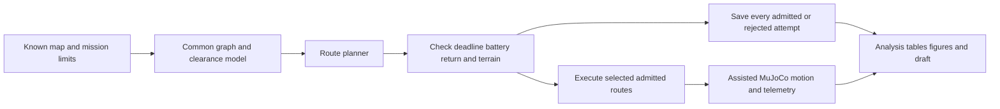

# Understanding the Pathfinder research

**4 November update:** The [IJ3C revision](../publication_2026_11_04/README.md) and [readiness assessment](../publication_2026_11_04/READINESS.md) supersede this guide for current results and publication status. The text below preserves the 3 November handoff context; manuscript links refer to the previous IEEE draft.

This guide explains the files inspected on 3 November 2026 for a newcomer taking over the draft. It separates what the software does, what the saved evidence supports, and what still needs work. This is a local-file review, not a new literature survey or an independent laboratory replication.

## The research question

Imagine sending a robot to a destination. The shortest route may cross slow rough ground, require expensive turns, or leave too little battery to return to a charger. This project asks whether a planner can find a useful compromise within a limited computation budget while respecting mission constraints.

The robot is a hexapod: six legs with three actuated joints per leg. The interactive demo also includes wheels and automatic wheel/leg changes. The main paper experiments use **walking only**, a known static map, and fixed locomotion behavior. They do not train a robot to walk or learn visual perception. The top-level Isaac Lab files are an older asset-import branch; the reported research runs in MuJoCo.

There are three layers:

1. **Robot/demo:** meshes, joints, terrain, destinations, charging stations and mission controls.
2. **Research:** generated maps, planners, common scoring rules, saved trials, audits and comparisons.
3. **Paper:** scripts turn saved records into tables and plots, then build a Word manuscript using an IEEE Access template.

The demo describes a 96 × 96 m area. The procedural research worlds use a 24 m half-extent, or 48 × 48 m. Do not copy demo dimensions into the experimental method without checking the campaign.

## How a mission flows through the software

The planner outputs body waypoints for the chassis. A controller and tripod gait attempt to follow them. A route can be found geometrically but rejected by mission limits, or admitted by the planner but fail during execution. Planning admission and successful execution are different outcomes.

The shared balanced score is:

`Q = distance_m / 50 + estimated_seconds / 90 + energy_percent / 30 + 0.25 × terrain_exposure / 20`

Lower Q is preferable after feasibility checks. The modeled battery requirement also reserves return energy: `1.25 × (outbound_energy + return_energy) + 6` percentage points must fit within available battery. Consumption coefficients, including 0.70 percentage points per walking metre, are assumptions. They were not fitted to real battery measurements.

Sources: [planning.py](../mujoco/research/planning.py), [score and ranking](../mujoco/research/swarm.py), [battery assumptions](../mujoco/energy_model.py), [final protocol](../mujoco/research/final_study.py).

## What the proposed planner adds

The retained proposal is `proposed_v4` in [advanced.py](../mujoco/research/advanced.py). It starts with a safe initial route, tries visible connections around selected obstacle and terrain landmarks, then moves intermediate waypoints to improve the route. Every candidate uses the common constraints and collision checks. A useful incumbent route is retained when further search stops.

Comparisons include distance/terrain/energy A*, earlier refiners, particle swarm optimization (PSO), and ant colony optimization (ACO). The final campaign compares six configurations: V4, polished PSO, polished ACO, OMPL RRT*, OMPL RRT* with a common incumbent, and OMPL RRTConnect. Polishing means local continuous waypoint refinement. Giving it to the swarm controls tests how much improvement comes from refinement rather than the proposal's other stages.

This is an integration and evaluation of established planning ideas, not a demonstrated new general optimization theory. The [OMPL adapter](../mujoco/research/external_planners.py) also has a narrower internal objective: turning history enters final evaluation but not native RRT*'s additive edge objective. The common-seeded control preserves a route in a shared candidate pool; it does not seed the native RRT* tree. These limitations constrain broad comparison claims.

## How the work developed

Version names can identify a planner, a campaign or a manuscript revision. Final V6 is the latest saved pipeline/package; the focal optimizer remains V4.

| Stage | Saved work | Meaning |
|---|---|---|
| Asset and mission demo | URDF/STLs, Isaac utilities, MuJoCo hybrid scene, charging and history | Engineering/demo foundation |
| Early reliability study | 168 scheduled attempts | Initial fixed-scene comparison |
| V3 strong study | 684 attempts, including 432 held-out planning attempts on 24 worlds | Adds procedural worlds and stronger controls |
| S1 / V4 | 1,232 attempts; 864 primary planning attempts, 24 worlds, 12 configurations | Develops retained V4, polished controls and feature-removal tests |
| S2 / V5 | 800 attempts; 384 primary attempts on 48 new test worlds | Adaptive V5 returned the same routes as V4 in all 96 matched primary attempts; retained as a negative result |
| S3 / V6 | 1,200 records; 576 primary attempts on 48 new worlds, six configurations | Adds actual external planners, sensitivity checks and revised tracking |

The current paper's S1–S3 total is **3,232 scheduled records**, not 3,232 independent worlds. Those campaigns have 24, 48 and 48 primary test worlds. Methods, repeated seeds and replay phases reuse worlds. The earlier reliability/V3 studies are additional history; do not combine every directory as though it were one predeclared experiment.

The latest draft is [Resource Constrained Hexapod Route Planning With Safe Tracking and External Planner Comparisons](../paper/previous_ieee_manuscript.pdf), prepared 29 October 2026, 19 pages. Its title page explicitly says review draft, not submitted, no DOI. It uses `TOMATO` and institution/email placeholders. Those labels do not verify authorship.

## The latest results in plain language

The final primary phase has 48 test worlds: 24 standard and 24 with predeclared friction/obstacle/terrain changes. Two repetitions per world give each configuration 96 attempts. Eight separate worlds support development and profile selection.

| Final configuration | Admitted / scheduled | Mean planner time |
|---|---:|---:|
| Proposal V4 | 90 / 96 | 0.441 s |
| Polished PSO | 88 / 96 | 0.263 s |
| Polished ACO | 88 / 96 | 0.432 s |
| OMPL RRT* | 77 / 96 | 1.365 s |
| OMPL RRT* with common incumbent | 90 / 96 | 1.383 s |
| OMPL RRTConnect | 78 / 96 | 0.066 s |

These are recorded search times on the original machine. Shared scene/graph/return preparation is separate. The proposal is not the fastest configuration.

Against polished PSO and ACO, the proposal's mean world-level Q improvements are **0.240%** and **0.473%**. Each comparison uses only jointly admitted trials across 44 worlds. Both median world improvements are **0%**. Many outcomes tie, some are worse, and a few worlds influence the mean. Q improvement is not the same as measured battery saving.

The saved descriptive 95% whole-world intervals are approximately [0.040%, 0.471%] and [0.187%, 0.789%]. They are uncorrected bootstrap intervals, not proof of universal superiority or practical importance. Repeated seeds are averaged within worlds before resampling worlds.

The revised safe follower completes **12/12** scheduled proposal missions on the selected final routes. The legacy follower also completes **12/12** on those same routes. A known earlier failure motivated the revision, but the final completion counts do not show a success-rate gain. Reduced assistance remains assistance. Across all V6 physics phases, 96 records were scheduled and 95 executed; the unadmitted record remains visible.

Sources: [primary summary](../paper/previous_ieee_tables/Final_Primary_Summary.csv), [paired comparisons](../paper/previous_ieee_tables/Final_Paired_Comparison.csv), [physics summary](../paper/previous_ieee_tables/Final_Physics_Summary.csv), [raw V6 study](../mujoco/outputs/research/final_validation_v6/), [handoff arithmetic check](verification/evidence_inventory.json).

## What has and has not been demonstrated

There is substantial software, saved routes/data, source/model provenance, analysis, figures, a manuscript, a compiled dashboard, and electrical-measurement templates. This handoff verified package hashes, reran the existing V6 internal audit and passed 50 tests in the portable workbench. That supports internal consistency; it does not establish simulator realism.

The [execution loop](../mujoco/research/execution.py) explicitly overwrites or blends chassis velocity and attitude. Gravity compensation remains enabled. Smooth simulated motion is therefore not proof of unassisted robot balance. Mechanical actuator work is a simulated measurement; it excludes the physical cost of assistance and is not battery electrical energy. Terrain exposure is a difficulty proxy, not a measured fall probability. The [electrical templates](../paper/electrical_validation/MEASUREMENT_PROTOCOL.md) contain no hardware measurements.

No physical robot trials, calibrated battery savings, learned perception or unassisted locomotion validation were established in this review. The draft discloses substantial AI assistance in code, experiments, analysis and writing. Keep that provenance accurate, verify the cited literature and technical content, and agree authorship with the supervisor.

## Your first reading session

Read this guide, the current Abstract, Section III, Section IV, then Sections VIII–X. Sections V–VI report the older S1 campaign: their 24-world and 72-attempt-per-method counts differ from final S3's 48 worlds and 96 attempts per method. Next inspect one admitted route, one rejection and one loss in the offline comparison. Follow a V6 trial from JSON to a table with the [file map](FILE_MAP.md).

For code, read `workbench/mujoco/research/run.py`, `planning.py`, `advanced.py`, `final_study.py` and `execution.py` in that order. See [the continuation plan](PAPER_ROADMAP.md) before designing changes.
