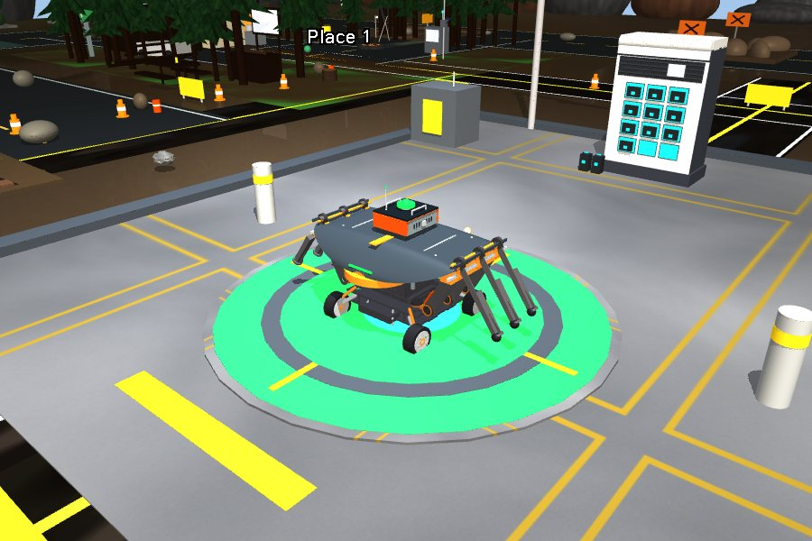
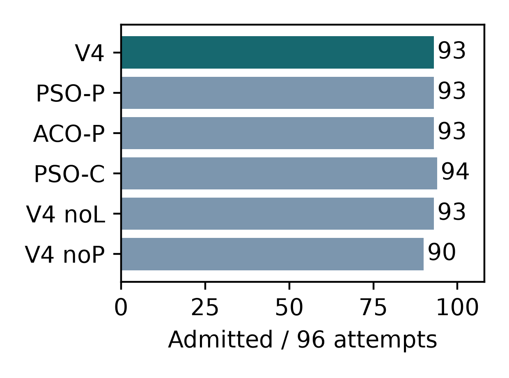
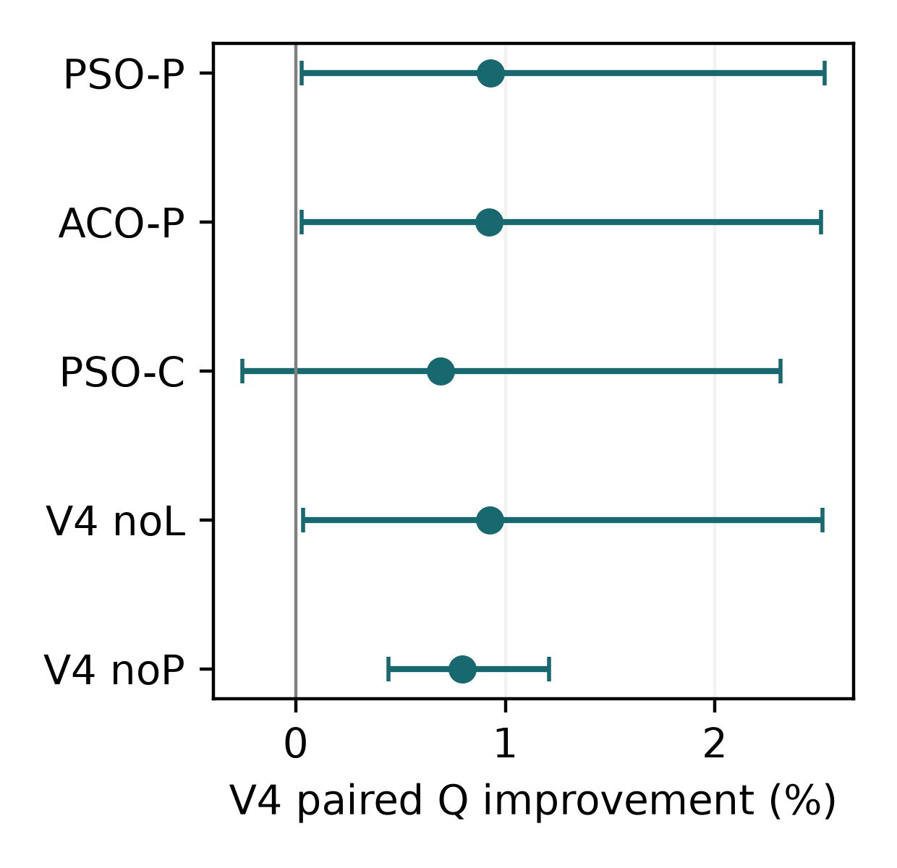

# Representation and Simulation Fidelity in Resource Constrained Hexapod Route Planning

[Author names, affiliations and corresponding email pending confirmation]

## Abstract

Route-planning comparisons can confound search behavior with waypoint representation and simulation assistance. This study evaluates a resource-constrained hexapod route-planning integration using a common distance, time, nominal battery and terrain score. A locally frozen prospective campaign contains eight development worlds, 32 fresh primary worlds, six configurations and 640 planning records. A continuous-coordinate particle swarm control and two component removals supplement polished swarm baselines. The retained V4 configuration admits 93/96 primary attempts. The coordinate control admits 94/96. V4's mean world-level score improvement over the continuous-coordinate control is 0.690% on jointly admitted cases, with median 0.000%. The descriptive 95% interval [-0.255, 2.312]% includes zero. An independent numeric and geometry audit checks all records. A separate 16-execution diagnostic examines chassis-assistance removal on four previously observed routes. The source and simulated assemblies have different modeled masses, and electrical parameters remain uncalibrated. The findings characterize a bounded engineering integration and its component trade-offs; they do not establish real battery savings or unassisted hardware locomotion.

Keywords: Hexapod; planning; optimization; simulation; reproducibility

## 1 Introduction

A robot route can be short yet unsuitable for its mission. Rough ground changes commanded travel speed, turns add time, and a destination may be reachable without leaving sufficient modeled battery for the return to a service station. These considerations motivate evaluating route geometry together with operational constraints. A simulation study can isolate such decisions, but only if its route-quality claims are separated from assumptions about locomotion and electrical consumption.

This article investigates a resource-constrained body-route planner for a custom hexapod model in MuJoCo [1]. The system uses a known static map, a fixed walking controller and a declared distance, time, nominal battery and terrain preference. It does not perform online perception, foothold optimization or reinforcement-learning training. The focal implementation, labelled V4 for provenance, combines safe corridor initialization, geometry-based visibility search and continuous waypoint refinement. Version labels identify archived implementations and campaigns rather than separate theoretical algorithms.

Two questions guide the evaluation. First, does the complete planner retain a useful route-quality or admission advantage when the comparison methods can also refine continuous waypoint coordinates? Second, do its landmark and polishing components contribute consistently on fresh generated maps? A separate diagnostic asks how strongly the saved execution results depend on direct chassis assistance. These questions narrow the contribution to a testable engineering integration and its evaluation boundaries.

The study contributes a common feasibility-first evaluation pipeline, a documented continuous-coordinate PSO representation control, and a prospective component study with frozen development and test splits. It also audits the actual robot parameters used in the simulator and explicitly tests assistance removal. The contribution is not a new general optimization principle, a proof of global optimality, or a claim of real battery savings. All scheduled outcomes are retained, including resource rejections, ties and losses.

## 2 Related work and comparison scope

A* guides graph search using accumulated costs and a heuristic [2]. Its guarantees concern the specified graph, costs and stopping conditions; they do not directly establish the best continuous robot route under a finite wall-clock allowance. Particle swarm optimization updates candidate positions using personal and global search information [3], while ant system methods use probabilistic construction and pheromone reinforcement [4]. In robotics comparisons, an optimizer's representation and initialization can matter as much as its update rule.

Visibility-based planning and path refinement are established geometric ideas [5]. Multicriteria path search motivates retaining alternatives that trade objectives against one another [6]. The present bounded corridor refiner limits computation and retained labels; it neither enumerates the complete Pareto set nor establishes a new shortest-path theorem. The final route is selected using declared scalar weights after resource checks.

The earlier study included actual Open Motion Planning Library controls [7], including RRT* [8]. Its native RRT* adapter uses an additive internal objective without turn history; common final evaluation includes the heading-aware costs. A preserved common incumbent belongs to the final candidate pool and is not an initialization of the native RRT* tree. Those adapter choices limit general statements about sampling-based planning and motivate the present additional representation and component controls. The new study does not claim to resolve every possible native-objective comparison.

Hexapod gait optimization and terrain-aware locomotion address related but different levels of the problem. Smart Gait evaluates trajectory, timing and gait adaptation on the LittleStrong platform [9]; the custom model here is not LittleStrong. Terrain-feature planning research also investigates how terrain affects hexapod motion [10]. The present comparison keeps gait behavior fixed and uses supplied terrain information. It does not reproduce those papers' complete perception, optimization or hardware systems.

Benchmark design requires explicit initialization, termination and accounting rules [11]. Repeated seeds within one world also should not be treated as independent maps; paired multi-dataset comparisons motivate examining effects across independent task instances [12]. Here, whole-world descriptive intervals accompany admission categories and effect-size distributions. They are not multiplicity-adjusted confirmatory significance tests.

## 3 Robot model and validity boundary

The source asset is named hexapod and is described in its files as a Fusion 360 export. It contains six legs and 18 revolute leg joints, three per leg. No verified commercial manufacturer or product model is identified by the files. URDF comments declare RS04 actuators and configure 60 Nm effort and 20 rad/s velocity limits. These are model declarations, not independently measured motor torque-speed, thermal or efficiency data.

The source URDF and the MuJoCo study assembly are not physically identical. The source link masses total 97.52 kg with a 35 kg base. The compiled MuJoCo robot subtree totals approximately 113.32 kg with a 46 kg base. The demo assembly includes procedural wheels and other additions. Its 23 actuators include the 18 leg actuators and additional simulated mechanisms; the main planning comparisons are explicitly walking-only. Table 1 records this discrepancy rather than silently presenting the CAD asset as validated hardware.

Table 1. Declared source and simulation parameters.

| Parameter | Source URDF | MuJoCo assembly |
| --- | --- | --- |
| Total mass (kg) | 97.52 | 113.32 |
| Base mass (kg) | 35.00 | 46.00 |
| Leg joints | 18 | 18 |
| Added mechanisms | No wheel joints | Wheels and scanner |

The physics timestep is 0.004 s, with four substeps per nominal 0.016 s control frame and gravity of 9.81 m/s squared. Eighteen limb bodies have ideal gravity compensation enabled. More importantly, the execution loop directly prescribes or blends chassis horizontal velocity, height correction, roll/pitch correction and yaw rate. At full assistance, each physics substep replaces horizontal body velocity with the commanded speed and direction. This supplies motion that is not generated solely by foot-ground forces and joint torques.

An assistance setting of 0.5 repeatedly blends velocity and posture; it is not half the physical support force. Setting that parameter to zero still retains ideal limb gravity compensation unless compensation is separately disabled. Mechanical actuator work therefore excludes the external contribution implicit in body assistance. It cannot be interpreted as full-system electrical energy. Figure 1 illustrates the existing demonstration assembly, not a new measured experiment or a commercial robot identification.

Figure 1. Existing assisted hybrid demonstration, illustrative only; controlled planner experiments use walking.

The evidence supports route selection inside the declared planar clearance and cost model. It does not validate material friction, deformable soil, sensor accuracy, actuator efficiency, real battery consumption or unassisted walking stability. Since only simulation files were available for this revision, no hardware calibration or physical experiment is reported.

## 4 Route formulation and common evaluation

A route P is an ordered list of planar chassis waypoints from a supplied start to a destination. All methods receive the same map, robot footprint, resource limits, starting heading and terrain model. The graph uses 0.25 m spacing and eight motion directions. The configured planar body-clearance radius is 1.82 m with an additional 0.12 m tracking margin. These are conservative planning parameters, not a measured hardware collision envelope. Diagonal moves cannot pass through occupied corners. Returned segments are checked continuously against the same footprint clearance model. These checks address planar body routing, not a guarantee of collision-free footholds or dynamic support.

The evaluator computes distance D in metres, predicted destination time T in seconds, nominal battery consumption E in percentage points and terrain exposure R. The balanced preference is given by equation (1), with weights w = (1/50, 1/90, 1/30, 0.25/20). Lower scores are preferable among admissible routes. A scalar score difference has no direct electrical unit.

{{EQ_SCORE}}

Admission requires the destination-time and exposure limits to be met. The available nominal battery must also cover equation (2), including the common return-to-charger estimate and reserve. The consumption model uses declared coefficients, including 0.70 percentage points per walking metre, 0.015 per second, 0.08 per turning radian and a start/stop allowance. These are scenario assumptions, not coefficients identified from voltage/current measurements.

{{EQ_BATTERY}}

The four procedural world families are open, clutter, rough and corridor. Research maps have a 24 m half-extent, distinct from the larger 96 by 96 m mission demonstration. A single world specification drives obstacle and shallow-terrain geometry together with planning queries. Semantic terrain difficulty and speed caps are supplied; they are not learned from images or measured soil. The shared evaluator keeps these assumptions common across methods, but common assumptions can still be physically inaccurate.

For the procedural walking tests, configured smooth, mild and higher-grade speed caps are 0.75, 0.65 and 0.38 m/s respectively. These values differ from some hybrid-demo settings. A 0.10 percentage-point start/stop allowance is included in the nominal battery model. The exact terrain construction, turning costs, resource limits and per-case return route are preserved with the manifest and source snapshots.

## 5 Planner and representation controls

### 5.1 Retained integrated planner

The retained V4 implementation begins with a resource-aware corridor incumbent. It constructs a bounded set of visible connections using initial-route points and selected obstacle/terrain landmarks, then applies collision-checked continuous waypoint polishing. Candidate ranking first prefers feasibility, then compares the declared route score. Useful incumbents survive search-budget exhaustion. Bounded labels, landmarks and candidate evaluations make the method approximate.

Polishing attempts shortcuts, projections, midpoint candidates and small coordinate displacements. Landmark search may escape the initial waypoint subsequence but consumes time that could otherwise improve that incumbent. Consequently, benefit from the full pipeline does not establish that every component is useful. The component-removal comparisons evaluate that question explicitly.

### 5.2 Existing and added comparison configurations

Polished PSO and ACO retain their original safe initial-route representations and receive the same final polishing operator. The new continuous-coordinate PSO control instead uses the shared corridor refiner to obtain an incumbent, then represents all internal waypoint xy positions as continuous particle coordinates within map bounds. Endpoints remain fixed. Safe subdivision retains original corners and provides at least six internal vertices. Vertex count is fixed within a trial; this remains one specified representation, not every possible continuous path-space swarm algorithm.

Particles receive Gaussian perturbations about the initial route. Personal and global updates use inertia, cognitive and social terms; velocities and positions are bounded. Candidates with colliding segments are discarded. The shared incumbent remains available even when particles do not improve it. Final polishing uses the same evaluator. Initial search, particle work and polishing share the same total wall allowance and evaluated-route ceiling. Counting collision-free route evaluations is distinguished from raw particle proposals and low-level visibility checks.

The coordinate control's default profile uses 12 particles, at most 40 iterations, inertia 0.65, cognitive/social coefficients 1.4, a 2 m perturbation and velocity bound, at least six internal vertices and a final polishing reserve of 25% of wall time. The alternative uses 20 particles, 60 iterations, inertia 0.75, coefficients 1.6 and a 4 m bound. All other settings remain unchanged. The default profile was selected on development data.

Two component controls remove landmarks or polishing from V4 while inheriting its selected development profile. They do not receive their own post-test parameter selection. This isolates the configured component changes more directly than a comparison with an independently tuned unrelated planner, although it does not explore every possible retuned ablation.

## 6 Experimental protocol

### 6.1 Earlier evidence and new prospective study

The earlier frozen S1, S2 and S3 campaigns contain 1,232, 800 and 1,200 scheduled records respectively. Their primary tests use 24, 48 and 48 worlds. These totals include method repetitions, development, sensitivities and execution replays; they must not be represented as 3,232 independent maps. S2 retained a negative enhancement result: the adaptive V5 candidate returned identical routes to V4 in all 96 matched primary attempts. S3 is the existing final-pipeline campaign; the new revision is separately labelled S4 in the accompanying materials.

S4 freezes eight development worlds with seeds 2130000 through 2130007 and 32 primary worlds with seeds 2140000 through 2140031. Each family contributes eight primary worlds. World hashes were checked against the earlier saved manifests and found disjoint. The seed sets are new, but the procedural generator families are related to the earlier ones; this is not validation on independently sourced real maps.

Four base configurations receive the same two-profile development opportunity: V4, polished PSO, polished ACO and continuous-coordinate PSO. A profile is selected by greatest admission count, then lowest admitted mean Q; exact ties retain the default. Profile selection precedes primary execution. The two component controls inherit V4's chosen settings. Development yields 64 records and primary evaluation yields 576 records: six configurations, 32 worlds and three paired repetitions per configuration, for 640 total planning records.

The default geometric profile allocates 40% of nominal wall time to initialization, a further bounded 32% to roadmap work, permits 44 landmarks and uses polishing steps of 0.75, 0.25 and 0.08 m. The alternative uses fractions 55% and 25%, 60 landmarks and steps of 0.50, 0.15 and 0.05 m. Selected complete swarm and geometric configurations are archived in locked_parameters.json, rather than mixing settings after primary evaluation.

Every primary planner receives a nominal 2 s allowance, a 240 evaluated-route ceiling and the common geometry/resources. Shared scene, graph, return-route and heuristic preparation are outside the per-method timer and recorded separately. The stop condition is a nominal allowance rather than a hard real-time guarantee. Runs occurred on a shared desktop; other processes and wall-clock scheduling can influence the number of search steps completed within a fixed allowance. Runtime comparisons require replication under controlled deployment workloads.

The manifest, source lock, development profiles and analysis rules were frozen locally before primary results. They were not externally preregistered. No primary outcome was used to change algorithms, choose cases, retune profiles or stop the campaign early. Saved sources and generated model hashes allow internal provenance checks. This revision adds no newly claimed hardware result.

### 6.2 Outcomes and analysis

Admission counts include every scheduled planning attempt. Paired Q comparisons retain only matched case/repetition pairs where both methods are admitted; proposal-only, baseline-only and mutual rejection are reported separately. Relative improvement is 100 times baseline Q minus proposal Q, divided by baseline Q. Repetitions are averaged within each world before world means and medians are calculated.

Descriptive 95% percentile intervals use 5,000 bootstrap draws of whole-world means with seed 41104. A declared 0.5 percent world-effect reference helps readers inspect practical magnitude; it is not a hypothesis-test threshold or a validated operational requirement. Multiple comparisons, conditional admission and the restricted map distribution limit interpretation. All paired world effects and raw attempts are included in CSV and JSON.

The S4 campaign is planning-only. Successful planning admission is not simulated mission completion. A separate post-hoc diagnostic replays the proposal's already observed S3 repetition-zero routes from its first four worlds under full, reduced and zero chassis assistance, then zero assistance with gravity compensation disabled. Four conditions on four existing worlds yield 16 diagnostic executions. These are sensitivity checks, not a fresh held-out locomotion benchmark. Existing motion guards and maximum duration remain active.

## 7 Results

### 7.1 Existing final-pipeline evidence

In S3, V4 admitted 90/96 primary attempts, versus 88/96 for each polished swarm control. The world-averaged paired improvements were approximately 0.240 percent over polished PSO and 0.473 percent over polished ACO, with zero median world improvement in both comparisons. Mean planning times were approximately 0.441, 0.263 and 0.432 s respectively. These small conditional gains and runtime trade-offs motivated the added representation and component checks.

The S3 safe and legacy followers each completed 12/12 scheduled proposal replays on exactly the same selected final routes. The revised follower rescued a known earlier development failure, but tied fresh completion counts did not establish a final-test success-rate advantage. Those original results are retained rather than superseded by the present diagnostic.

### 7.2 Fresh representation and component results

All 640 scheduled planning records completed. The frozen profile choices were V4: default, PSO-P: default, ACO-P: default, PSO-C: default. Table 2 reports admission and per-method search time; Figure 2 shows admission counts. V4 noL removes landmark diversification and V4 noP removes polishing. PSO-P and ACO-P are the existing polished controls; PSO-C is the added continuous-coordinate control. V4 admits 93/96 attempts with mean search time 0.376 s. PSO-C admits 94/96 with mean search time 0.731 s. The coordinate control therefore admits one more primary attempt than V4 in this campaign. These are observed configuration-specific outcomes, not a claim about every implementation of either algorithm family.

Table 2. S4 admission and mean planner wall time.

| Method | Admitted / 96 | Mean time (s) |
| --- | --- | --- |
| V4 | 93 | 0.376 |
| PSO-P | 93 | 0.223 |
| ACO-P | 93 | 0.335 |
| PSO-C | 94 | 0.731 |
| V4 noL | 93 | 0.196 |
| V4 noP | 90 | 0.329 |

Figure 2. Fresh S4 primary admission counts; all scheduled attempts retained.

Against PSO-C, V4 has 33 lower-score pairs, 27 ties and 33 higher-score pairs among joint admissions. The remaining categories are 0 V4-only admissions, 1 PSO-C-only admissions and 2 mutual rejections. The world-averaged effect is 0.690% (descriptive 95% interval [-0.255, 2.312]%), based on 31 paired worlds. The median is 0.000%; 5 paired worlds exceed the declared 0.5% reference. World effects range from -1.718% to 23.202%. The interval against PSO-C spans zero, so this sample does not establish a reliable nonzero mean score advantage over that control. Against V4 noL the mean effect is 0.924% and against V4 noP it is 0.794%. Positive effects favor complete V4; negative effects favor the control. Table 3 retains the full intervals, including intervals spanning zero, and Figure 3 displays their direction. Component benefits must be interpreted on this new sample rather than inferred from the method name.

Table 3. V4 relative score effects on joint admissions.

| Control | Mean (%) | 95% interval (%) |
| --- | --- | --- |
| PSO-P | 0.929 | [0.027, 2.523] |
| ACO-P | 0.921 | [0.029, 2.507] |
| PSO-C | 0.690 | [-0.255, 2.312] |
| V4 noL | 0.924 | [0.036, 2.513] |
| V4 noP | 0.794 | [0.443, 1.209] |

Figure 3. V4 paired world-level effects and descriptive 95% intervals. Positive values favor V4.

Table 2 counts all scheduled attempts and averages search time over them. Table 3 and Figure 3 compare route quality using matched admitted pairs and whole-world averaging. A mean effect above zero does not mean every trial improves, and a zero median indicates that at least half the paired world effects lie at or below zero or tie. The complete per-world distribution is supplied to avoid relying on a single average.

### 7.3 Assistance sensitivity and integrity

Table 4 summarizes the assistance-removal conditions and their outcomes.

Table 4. Diagnostic replay outcomes on observed routes.

| Condition | Arrived / scheduled | Executed |
| --- | --- | --- |
| Full + GC | 4/4 | 4 |
| Blend + GC | 4/4 | 4 |
| Zero + GC | 0/4 | 4 |
| Zero, no GC | 0/4 | 4 |

Table 4 separates completed routes from the conditions actually executed. Full + GC: 4/4 arrived, outcomes {'arrived': 4}; Blend + GC: 4/4 arrived, outcomes {'arrived': 4}; Zero + GC: 0/4 arrived, outcomes {'timeout': 4}; Zero, no GC: 0/4 arrived, outcomes {'timeout': 4}. GC denotes ideal limb gravity compensation. Timeouts mean the saved complete mission did not arrive within 180 simulated seconds, not necessarily that the robot fell. This diagnostic was conducted on already observed routes and cannot estimate general real-world failure rates. Nevertheless, a completion difference under assistance removal shows that assisted results cannot be treated as equivalent evidence for autonomous dynamic locomotion.

The new audit passes 640 records, checks 187 distinct route geometries and recomputes 748 metric values with no reported errors. It also checks trial keys, frozen development selection, source snapshots, model hashes, endpoints and common score/admission arithmetic. The software verification log records 63 passing test executions, including imported existing cases and three new representation checks. No trial was removed to improve the reported result.

The numerical audit verifies the saved records against the declared evaluator and geometry. It is not independent laboratory replication and does not validate physical parameters. The software tests exercise implementations and persistence; they cannot establish practical novelty or journal acceptance.

## 8 Discussion and limitations

The relevant scientific question is when the integrated search earns its additional complexity under declared constraints. Small conditional score differences must be weighed against runtime, tuning opportunity and representation. Component removal is especially useful when a named stage is proposed as the reason for an improvement. A full method can be competitive while one of its stages provides little consistent benefit on a given distribution.

The continuous-coordinate PSO control broadens the comparison beyond selecting subsequences of a starting corridor. It still uses a fixed vertex count, a shared incumbent and a particular particle update configuration. Different waypoint-count adaptation, constraints, initialization or objective formulations could alter the outcome. Its inclusion supports a more careful comparison; it does not establish superiority over all continuous swarm planners. Likewise, the earlier native RRT* adapter limitation remains unresolved by this experiment.

New seeds reduce reuse of observed worlds, but all S4 worlds come from the existing four procedural families. The nominal battery score and supplied terrain-speed map embed assumptions that favor no method exclusively yet may fail to represent physical operations. Perturbing a fixed simulator cannot replace calibration of mass, inertia, friction, actuator response, localization and electrical consumption against measurements.

The source/demo mass difference is particularly important for interpretation. A correct route planner can operate on a model whose mass or actuation capability is not representative of a real robot. The assistance-removal diagnostic further separates usable navigation demonstrations from dynamically autonomous locomotion. Even successful low-assistance runs would not by themselves verify real-world walking, because the remaining simulator and controller assumptions would still require validation.

No hardware was available, so the next physical-validation stage remains outside this article. A future study would measure the assembled mass and inertias, validate actuator torque-speed and thermal behavior, characterize surface contact, and integrate synchronized battery voltage and discharge current over missions. Calibration and validation missions/maps should be disjoint. Until then, claims are restricted to modeled route quality, internal software checks and explicitly assisted simulation behavior.

## 9 Conclusions

This work evaluates a resource-constrained route-planning integration for a custom simulated hexapod. Shared feasibility checks combine deadline, nominal battery-return reserve, terrain exposure and conservative planar clearance before a declared balanced score. The revision adds a continuous-coordinate representation control, component removals, a fresh locally frozen planning campaign and an explicit audit of the robot and assistance assumptions.

On 32 fresh generated primary worlds, V4 admits 93/96 attempts. The paired mean effect against the continuous-coordinate control is 0.690%, with median 0.000%. The component comparisons yield mean effects of 0.924% against removal of landmarks and 0.794% against removal of polishing. These measured trade-offs and the assistance diagnostic constrain the claims that can be made from the simulator. Further algorithmic or physical conclusions require a separately designed evaluation addressing the corresponding limitation.

The contribution is a reproducible simulation evaluation with limited, conditional findings. It does not establish a validated commercial robot model, real battery savings or unassisted walking stability. The preserved raw records and negative outcomes support further investigation without requiring a claim of universal planner superiority.

## Data and code availability

The review bundle contains S4 manifests, selected profiles, phase records, archived sources, generated model hashes, all 640 attempt rows, paired world effects, the assistance diagnostic, the model audit and scripts for analysis and manuscript generation. Earlier S1-S3 records remain in their existing frozen packages and are identified in the provenance notes. A persistent public archive identifier has not yet been assigned and must be completed by the authors before submission. Fresh wall-clock runs need not reproduce identical coordinates or timings.

## Acknowledgments

OpenAI Codex assisted software implementation, study orchestration, analysis, figures and drafting. Numeric results come from archived simulator executions and calculations, not fabricated observations. Author names, affiliations, funding, competing-interest declarations and final approval remain to be confirmed by the human authors. This review draft does not assign authorship or claim acceptance.

## References

[1] E. Todorov, T. Erez, and Y. Tassa, "MuJoCo: A physics engine for model-based control," in Proc. IEEE/RSJ Int. Conf. Intell. Robots Syst., 2012, pp. 5026–5033, doi: 10.1109/IROS.2012.6386109.

[2] P. E. Hart, N. J. Nilsson, and B. Raphael, "A formal basis for the heuristic determination of minimum cost paths," IEEE Trans. Syst. Sci. Cybern., vol. 4, no. 2, pp. 100–107, 1968, doi: 10.1109/TSSC.1968.300136.

[3] J. Kennedy and R. Eberhart, "Particle swarm optimization," in Proc. ICNN Int. Conf. Neural Netw., vol. 4, 1995, pp. 1942–1948, doi: 10.1109/ICNN.1995.488968.

[4] M. Dorigo, V. Maniezzo, and A. Colorni, "Ant system: Optimization by a colony of cooperating agents," IEEE Trans. Syst., Man, Cybern. B, vol. 26, no. 1, pp. 29–41, 1996, doi: 10.1109/3477.484436.

[5] T. Lozano-Pérez and M. A. Wesley, "An algorithm for planning collision-free paths among polyhedral obstacles," Commun. ACM, vol. 22, no. 10, pp. 560–570, 1979, doi: 10.1145/359156.359164.

[6] E. Q. V. Martins, "On a multicriteria shortest path problem," Eur. J. Oper. Res., vol. 16, no. 2, pp. 236–245, 1984, doi: 10.1016/0377-2217(84)90077-8.

[7] I. A. Şucan, M. Moll, and L. E. Kavraki, "The Open Motion Planning Library," IEEE Robot. Autom. Mag., vol. 19, no. 4, pp. 72–82, Dec. 2012, doi: 10.1109/MRA.2012.2205651.

[8] S. Karaman and E. Frazzoli, "Sampling-based algorithms for optimal motion planning," Int. J. Robot. Res., vol. 30, no. 7, pp. 846–894, 2011, doi: 10.1177/0278364911406761.

[9] Y. Yin, F. Gao, Q. Sun, Y. Zhao, and Y. Xiao, "Smart Gait: A gait optimization framework for hexapod robots," Chin. J. Mech. Eng., vol. 37, Art. no. 15, 2024, doi: 10.1186/s10033-024-01000-0.

[10] C. Chen, J. Lin, B. You, J. Li, and B. Gao, "Hexapod robot motion planning investigation under the influence of multi-dimensional terrain features," Front. Neurorobot., vol. 19, Art. no. 1605938, 2025, doi: 10.3389/fnbot.2025.1605938.

[11] N. Hansen, A. Auger, R. Ros, O. Mersmann, T. Tušar, and D. Brockhoff, "COCO: A platform for comparing continuous optimizers in a black-box setting," Optim. Methods Softw., vol. 36, no. 1, pp. 114–144, 2021, doi: 10.1080/10556788.2020.1808977.

[12] J. Demšar, "Statistical comparisons of classifiers over multiple data sets," J. Mach. Learn. Res., vol. 7, pp. 1–30, 2006. [Online]. Available: https://www.jmlr.org/papers/v7/demsar06a.html

