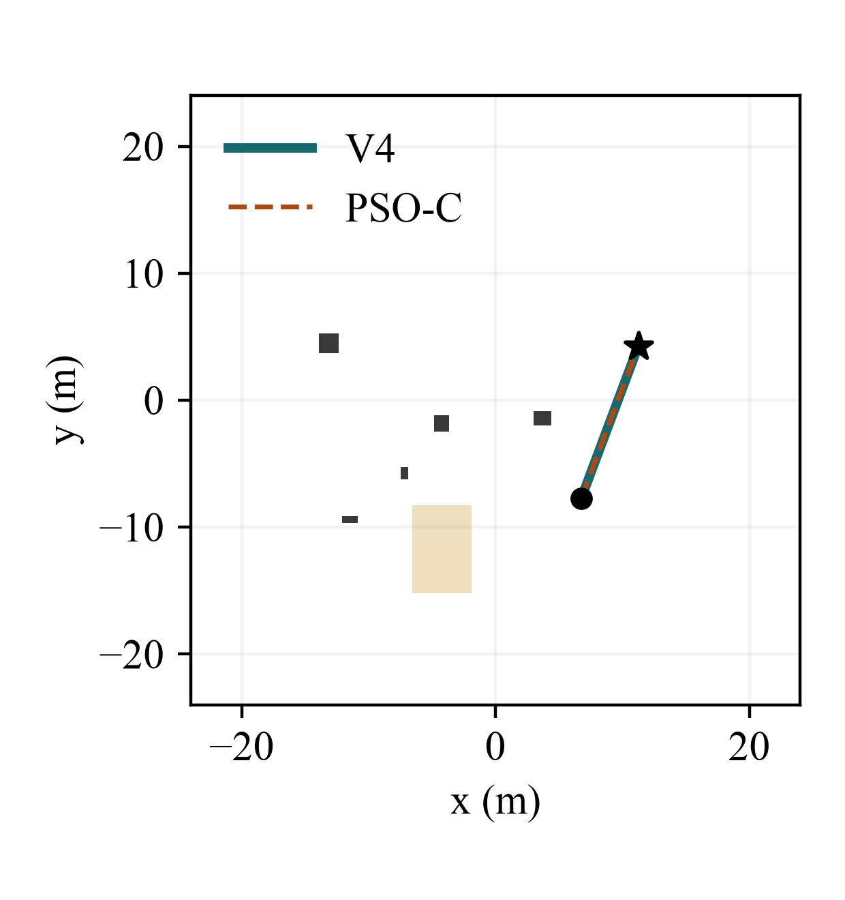
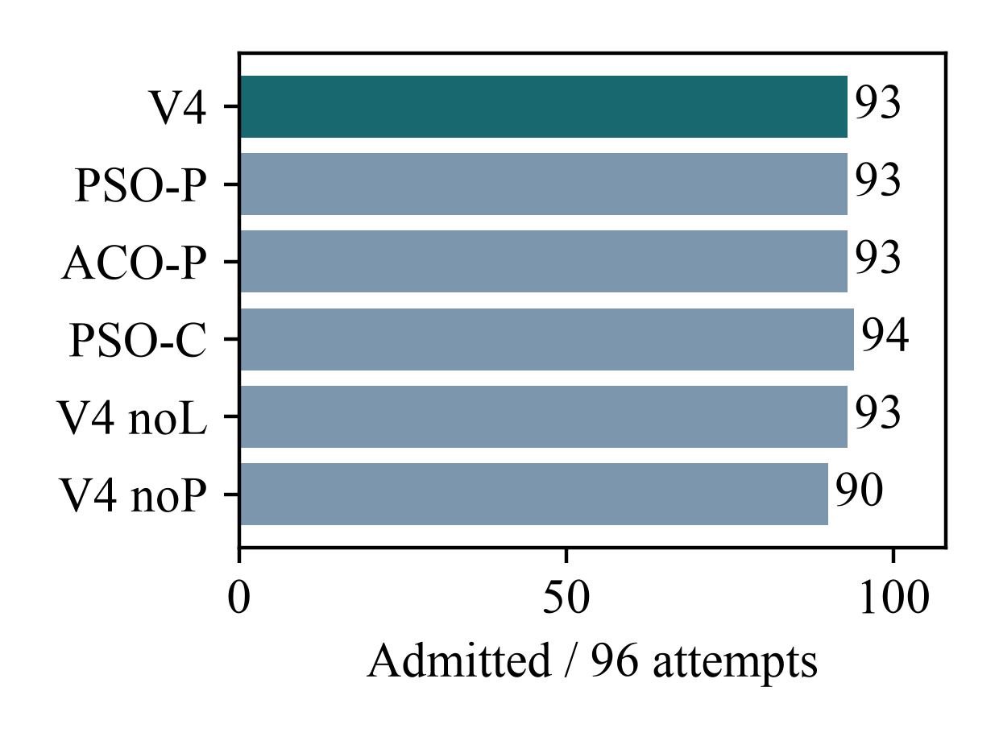
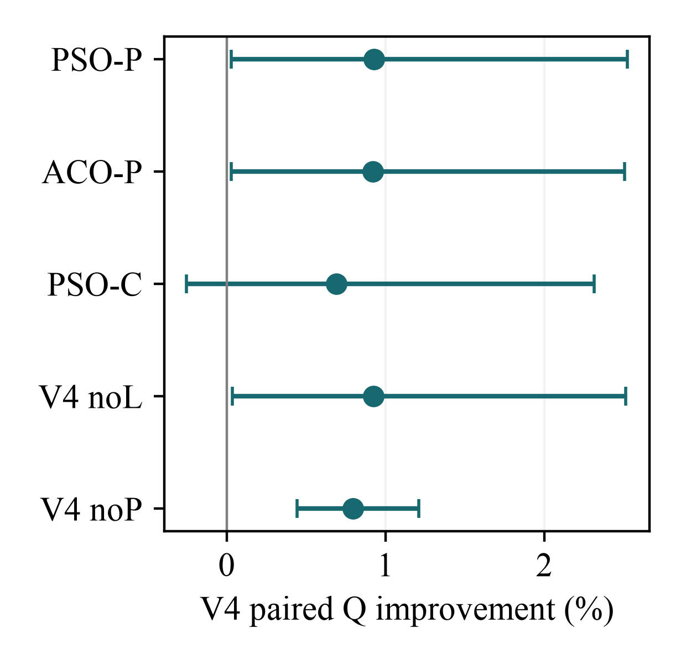

# Waypoint Representation and Chassis Assistance in Simulated Hexapod Route Planning

[Author names and affiliations]
[Corresponding author email]

## Abstract

This study evaluates waypoint representation and component removal in resource-constrained route planning for a simulated hexapod. Six configurations share geometric clearance checks, mission limits and a distance, time, nominal battery and terrain score. A locally frozen campaign comprises eight development worlds and 32 primary worlds, yielding 640 planning records. The complete geometric refiner, V4, admits 93/96 primary attempts; a continuous-coordinate particle swarm control admits 94/96. On joint admissions, V4 has a mean world-level score improvement of 0.690%, a median of 0.000% and a descriptive 95% bootstrap interval of [-0.255, 2.312]%. The interval spans zero. Removing landmarks retains 93 admissions; removing polishing reduces admissions to 90. A separate diagnostic replays four archived missions under four assistance conditions. Full and reduced chassis assistance each complete all four missions; zero assistance times out on all four, with or without limb gravity compensation. The findings quantify configuration-specific planning trade-offs and assistance dependence in the declared simulator. No physical robot performance or electrical energy saving is established.

Keywords: Hexapod; planning; optimization; simulation; reproducibility

## 1 Introduction

Resource-constrained navigation requires a route to satisfy operational limits as well as geometric clearance. In the model studied here, travel time depends on terrain-dependent walking speeds and heading changes, while route admission also requires a nominal battery allowance for travel to the destination and return to a charging station. Route length alone therefore does not determine admission or the configured route score.

This study evaluates an integrated geometric route refiner for a simulated hexapod in MuJoCo [1]. The refiner combines a resource-aware corridor incumbent, a bounded visibility search and continuous waypoint polishing. The comparison addresses two implementation questions: performance against a specified continuous-coordinate particle swarm control, and the effects of removing landmark search or polishing from the integrated refiner. All methods use a common map, cost evaluator, clearance query and mission limits.

The contribution is a controlled comparison of these configurations on a locally frozen development and primary-test protocol, together with a diagnostic of chassis assistance in the execution model. The primary outcome is route admission; route-score differences are evaluated on joint admissions. The diagnostic evaluates dependence of simulated completion on direct chassis control. The article reports planning and assisted-simulation outcomes; it does not report hardware measurements.

## 2 Related work

The initialization uses heuristic graph search in the tradition of A* [2]. Particle swarm optimization [3] and ant system [4] provide the search mechanisms underlying the swarm controls. The compared implementations differ in route representation: the existing controls select safe subsequences of seeded corridors, whereas the coordinate control moves internal vertices in the plane. Final collision checks and scalar evaluation are shared. Consequently, the comparison concerns the specified implementations and their representations, rather than an ordering of entire algorithm families.

Visibility-graph planning connects mutually visible points around modeled obstacles [5]. The integrated refiner uses this geometric construction with bounded landmarks, heading-dependent costs and local polishing. Its finite search budget and retained-label limits make it approximate; no global-optimality or complete Pareto-front claim is made.

Hexapod locomotion studies address additional variables. Yin et al. optimize swing trajectories, gait timing and gait sequence on the LittleStrong platform [6]. Chen et al. combine multidimensional terrain features with traversal costs, foothold costs and gait planning, with simulation and physical experiments [7]. The present study holds locomotion behavior fixed and supplies the terrain map. It evaluates body-route selection and assistance dependence, without reproducing those studies' gait adaptation or hardware validation. Explicit initialization, tuning and termination accounting follow the benchmarking concerns described by the COCO project [8].

## 3 Robot and route model

### 3.1 Robot assembly and execution assumptions

The source asset is named hexapod and is identified in its files as a Fusion 360 export. It has six legs and 18 revolute leg joints. The files do not identify a commercial product model. Source URDF comments identify RS04 actuators, and the joint limits specify 60 Nm effort and 20 rad/s velocity. These values are configuration inputs, rather than measured torque-speed characteristics.

Table 1 compares the source description with the compiled MuJoCo robot subtree. The source totals 97.52 kg with a 35 kg base; the simulation totals approximately 113.32 kg with a 46 kg base. The simulation includes procedural wheels and a scanner, with 23 actuators overall. Both the planning comparison and diagnostic replays use walking mode. The source and simulated assemblies are therefore distinct mass models.

Table 1. Declared source and simulation parameters.

| Parameter | Source URDF | MuJoCo assembly |
| --- | --- | --- |
| Total mass (kg) | 97.52 | 113.32 |
| Base mass (kg) | 35.00 | 46.00 |
| Leg joints | 18 | 18 |
| Added mechanisms | No wheel joints | Wheels and scanner |

The physics timestep is 0.004 s; the execution controller uses four substeps per 0.016 s frame. Gravity is 9.81 m/s squared, and 18 limb bodies have gravity compensation enabled. The controller directly blends chassis vertical velocity and roll/pitch rates once per frame, and horizontal velocity and yaw rate at each physics substep. At assistance 1, the horizontal velocity is replaced by the commanded velocity. At assistance 0.5, repeated blending is applied; this value does not specify a physical support force. Assistance 0 removes those direct velocity corrections, while limb gravity compensation remains active unless separately disabled.

### 3.2 Geometry and cost evaluation

A route P is an ordered sequence of planar chassis waypoints from the supplied start to the destination. The grid spacing is 0.25 m with eight motion directions and blocked-corner rejection. Every returned segment is checked against the common planar obstacle geometry using a configured 1.82 m clearance radius, 0.12 m tracking margin and 0.005 m segment-clearance tolerance. These parameters define the planning envelope; they are not a measured three-dimensional foot or body envelope.

The common evaluator returns distance D in metres, destination travel time T in seconds, nominal battery consumption E in percentage points and terrain exposure R. Travel time includes segment distance divided by the configured local walking speed, heading changes at 1 rad/s and an acceleration allowance. Smooth, mild and higher-grade speed caps are 0.75, 0.65 and 0.38 m/s. Terrain exposure sums segment length times mean grid difficulty sampled at spacing no greater than 0.125 m. The initial heading is π/2 radians for all trials. The balanced score is equation (1), where w = (1/50, 1/90, 1/30, 0.25/20).

$$Q(P)=D/50+T/90+E/30+R/80\qquad (1)$$

A route is admitted only if it meets its deadline, terrain-exposure budget and nominal battery constraint. Equation (2) defines the required battery allowance, where subscript return denotes the common destination-to-station estimate and the constant 6 is a reserve in percentage points.

$$B_{\mathrm{req}}=1.25(E+E_{\mathrm{return}})+6\qquad (2)$$

The consumption model assigns 0.70 percentage points per walking metre, 0.015 per second, 0.08 per turning radian and a 0.10 start/stop allowance. These coefficients define the benchmark cost model and were not calibrated against electrical measurements. Neither Q nor a difference in Q is a measured energy saving. Figure 1 shows the first frozen primary case and the compared routes; it is an example of the evaluated geometry, rather than evidence of physical traversal.

Figure 1. First primary world, seed 2140000, repetition 0. Circles and stars mark start and goal; black blocks are obstacles and amber regions are terrain patches. Coincident route segments overlap.

## 4 Compared planning configurations

### 4.1 Integrated geometric refiner

The complete implementation is denoted V4 to match the archived source. A charged resource-aware corridor stage supplies an incumbent. A bounded visibility graph adds candidate connections through route vertices and obstacle/terrain landmarks. The final polishing stage tests vertex deletion, projections, midpoint replacements and coordinate displacements. All accepted candidates pass the shared segment-clearance query.

Candidate ranking first distinguishes feasible routes, then minimizes normalized constraint violation and finally Q. Among feasible routes, Q determines the retained incumbent. An incumbent is preserved when later search stages exhaust their allowance. The selected default profile allocates 40% of the nominal wall allowance to initialization, up to a further 32% to visibility work, at most 44 landmarks and polishing displacement scales of 0.75, 0.25 and 0.08 m. The corridor refiner uses beam width 6, eight labels per state and an archive of 16 routes.

### 4.2 Swarm and component controls

PSO-P and ACO-P are the existing corridor-subsequence swarm implementations followed by the common polishing operator. PSO-P uses 16 particles, inertia 0.72, cognitive/social coefficients 1.49, velocity clipping at 0.25 and at most 40 iterations per corridor. ACO-P uses 12 ants, pheromone and heuristic exponents 1 and 2, evaporation 0.20, deposit 1 and at most 40 iterations per corridor. Both receive the seeded-corridor portfolio and the shared total planning allowance.

The continuous-coordinate control, PSO-C, starts from the same configured corridor refiner used for V4 initialization. It subdivides the longest segments until there are at least six internal vertices, preserving existing corners. Endpoints remain fixed, and internal xy coordinates form the particle state. Vertex count is fixed during each trial. The selected profile uses 12 particles, at most 40 iterations, inertia 0.65, cognitive/social coefficients 1.4, Gaussian perturbations of scale 2 m and velocity clipping at 2 m. Positions are clipped to map bounds. Colliding particle proposals are discarded, and the shared incumbent remains available. Final polishing reserves the last 25% of the nominal allowance.

V4 noL removes landmark search; V4 noP removes final polishing. These controls inherit the selected V4 profile. They isolate removal of the configured stage, without independent retuning. The six configurations share a nominal 2 s allowance and a ceiling of 240 evaluated collision-free routes, including charged initialization evaluations. Visibility checks and rejected particle proposals are recorded separately and are not equivalent to route evaluations.

## 5 Experimental protocol

### 5.1 Worlds and development selection

The protocol contains eight development worlds with seeds 2130000-2130007 and 32 primary worlds with seeds 2140000-2140031. Families cycle through open, clutter, rough and corridor; each contributes eight primary worlds. All maps have a 24 m half-extent. The same world specification supplies obstacles, shallow terrain tiles and semantic speed regions. Obstacle counts for the four families are 5, 16, 7 and 4, with the corridor family additionally containing two interrupted barriers. Terrain-patch counts are 1, 2, 4 and 3. Generated map specifications and their hashes are retained in the manifest.

Start and goal proposals are sampled within [-17, 17] m with initial separation 12-26 m, mapped to free grid locations and retained with separation at least 10 m. Per-case deadlines are sampled from 45, 70, 110 and 160 s; nominal battery allowances from 45, 65, 85 and 100%; and exposure limits from 10, 20 and 40. All compared methods receive the identical case. Return-to-station routes and costs are prepared once for that case. Saved world hashes are disjoint from the earlier campaign manifests, but the generator families are shared with the earlier work.

Each of four base configurations receives two complete development profiles. Selection first maximizes admitted attempts, then minimizes mean Q among admissions; exact ties retain the default. The alternative changes PSO-P to 24 particles, inertia 0.55 and cognitive/social coefficients 1.7/1.3; ACO-P to 18 ants, heuristic exponent 3 and evaporation 0.35; and PSO-C to 20 particles, 60 iterations, inertia 0.75, cognitive/social coefficients 1.6 and a 4 m perturbation/velocity bound. The geometric alternative uses initialization/visibility fractions 0.55/0.25, 60 landmarks and polishing scales 0.50, 0.15 and 0.05 m. Complete profiles, including inherited values, are archived. The default was selected for every base configuration before the primary test. Component controls inherit V4's choice.

Development contributes 64 planning records. Primary evaluation uses six configurations, 32 worlds and three paired repetitions, giving 576 records and 96 attempts per configuration. The complete campaign therefore contains 640 planning records. The manifest, source lock and selection rules were frozen locally before primary outcomes; there was no external preregistration. No primary case or unfavorable outcome was removed.

### 5.2 Runtime and outcome accounting

The scientific environment was Python 3.10.12, MuJoCo 3.9.0, NumPy 2.2.6 and SciPy 1.15.3 on Linux with an Intel Core i5-7600 CPU at 3.50 GHz and four logical processors. Scene loading, graph construction, return-route preparation and common heuristic preparation are recorded outside the per-method timer. The 2 s allowance is a search stop condition, rather than a hard real-time deadline. Runs occurred on a shared desktop with concurrent workloads; the recorded wall times characterize that execution environment.

Admission includes all scheduled primary attempts. A planning admission does not assert simulated mission completion. Paired Q comparisons include only case/repetition pairs admitted by both configurations. V4-only, control-only and mutual rejections remain separate outcome categories. For each jointly admitted pair, the relative score effect is equation (3), where subscripts c and v denote the control and V4 scores. Positive effects favor V4. Repetitions are averaged within each world before calculating across-world summaries.

$$\delta=100(Q_c-Q_v)/Q_c\qquad (3)$$

Descriptive 95% percentile intervals use 5,000 bootstrap resamples of the paired world means, with random seed 41104 [9]. The world is the resampling unit; repetitions within a world are not counted as independent maps. Intervals are unadjusted for the five control comparisons and conditional on joint admission. The locally frozen analysis also reports medians, effect ranges and counts above a descriptive 0.5% reference. This reference is not a validated operational benefit threshold.

### 5.3 Assistance diagnostic

A separate post-hoc diagnostic uses V4 repetition-zero routes from the first four worlds of the archived final-pipeline campaign, identified as v6test_01-v6test_04 in the supplied input. Each replay includes the saved destination route and return to a service station. The four conditions are full assistance with gravity compensation, 0.5 assistance with compensation, zero assistance with compensation, and zero assistance without compensation. All 16 executions use the same safe follower and a maximum duration of 180 simulated seconds. The selected routes were already observed, so this diagnostic is not an additional held-out locomotion test.

## 6 Results

### 6.1 Planning admission and paired scores

All 640 scheduled records completed. Development selected the default profile for every base configuration. V4, PSO-P, ACO-P and V4 noL each admit 93/96 primary attempts; PSO-C admits 94/96 and V4 noP admits 90/96. Table 2 reports admission and mean planner wall time; Figure 2 shows the admission counts. V4 records a mean search time of 0.376 s, compared with 0.731 s for PSO-C. All non-admitted primary outcomes are resource rejections; no primary trial has an error status.

Table 2. Primary admission and mean planner wall time.

| Method | Admitted / 96 | Mean time (s) |
| --- | --- | --- |
| V4 | 93 | 0.376 |
| PSO-P | 93 | 0.223 |
| ACO-P | 93 | 0.335 |
| PSO-C | 94 | 0.731 |
| V4 noL | 93 | 0.196 |
| V4 noP | 90 | 0.329 |

Figure 2. Primary admission counts across all scheduled attempts.

Against PSO-C, V4 has 33 lower-score pairs, 27 ties and 33 higher-score pairs among joint admissions. There are 0 V4-only admissions, 1 PSO-C-only admission and 2 mutual rejections. The world-averaged score effect is 0.690% with a descriptive 95% interval [-0.255, 2.312]%, based on 31 worlds. The median is 0.000%; world effects range from -1.718% to 23.202%, with 5/31 above the declared 0.5% reference. The mean effects against PSO-P and ACO-P are 0.929% and 0.921%, respectively, both with zero median. The component comparisons yield mean effects of 0.924% against V4 noL and 0.794% against V4 noP. Against V4 noL, V4 has 27 lower-score pairs, 57 ties and 9 higher-score pairs. Against V4 noP, it has 57 lower-score pairs, 33 ties and 0 higher-score pairs, plus 3 V4-only admissions. Table 3 and Figure 3 report the corresponding conditional mean effects and intervals.

Table 3. V4 score effects; n is the paired world count.

| Control | n | Mean (%) | 95% interval (%) |
| --- | --- | --- | --- |
| PSO-P | 31 | 0.929 | [0.027, 2.523] |
| ACO-P | 31 | 0.921 | [0.029, 2.507] |
| PSO-C | 31 | 0.690 | [-0.255, 2.312] |
| V4 noL | 31 | 0.924 | [0.036, 2.513] |
| V4 noP | 30 | 0.794 | [0.443, 1.209] |

Figure 3. Conditional V4 score effects and descriptive 95% intervals. Positive values favor V4.

The admission denominators in Table 2 include all primary attempts. The score summaries in Table 3 and Figure 3 use joint admissions and average repetitions within worlds. V4 noP has 30 paired worlds; the other comparisons have 31. The paired world effects, trial-level admission categories and all scheduled attempts are included in the supplementary records.

### 6.2 Diagnostic outcomes and record integrity

Table 4 reports completion under each assistance condition.

Table 4. Diagnostic replay outcomes on observed routes.

| Condition | Arrived / 4 | Timeout / 4 |
| --- | --- | --- |
| Full + GC | 4 | 0 |
| Blend + GC | 4 | 0 |
| Zero + GC | 0 | 4 |
| Zero, no GC | 0 | 4 |

Full assistance and 0.5 assistance each complete 4/4 missions. Both zero-assistance conditions time out on all four missions before the 180 s limit. GC in Table 4 denotes limb gravity compensation. A timeout records failure to complete the saved destination-and-return mission within the configured duration; it does not classify a fall. These outcomes apply to the four archived routes and do not estimate hardware failure rates.

An internal record audit reconciles all 640 records, checks 187 distinct route geometries and recomputes 748 metric values without an error. It verifies trial keys, development selection, source/model hashes, endpoints, clearance and score/admission arithmetic. These checks establish consistency with the declared evaluator, not independent physical validation.

## 7 Discussion

The coordinate representation control changes the interpretation of the complete planner's performance. PSO-C admits one more attempt than V4, and the descriptive interval for their paired mean score effect spans zero. The comparison therefore does not establish a mean score advantage for V4 against PSO-C. Against the corridor-subsequence controls, the positive mean effects coexist with zero medians and losses. The observed benefits are conditional on the configured representations, resource limits and sampled maps.

The component comparisons identify distinct trade-offs. Removing landmarks retains the admission count and lowers recorded mean search time, while its paired mean Q is higher. Removing polishing reduces admissions by three and has no lower-score joint admission than complete V4. These results support retaining polishing for this tested configuration, while landmark search trades additional recorded computation for a small, uneven score effect. The shared-desktop timing conditions prevent a controlled deployment-latency conclusion.

The assistance diagnostic establishes dependence of completion on direct chassis corrections for the four replayed missions. Removing those corrections produces timeouts under both gravity-compensation settings. This is an execution-model result, not an estimate of hardware failure probability. Mechanical joint work excludes the assistance contribution and cannot represent total electrical consumption. The differing source/simulation masses and uncalibrated consumption coefficients further restrict the findings to the declared simulator.

The primary maps come from four related procedural families; they do not establish performance on independently measured terrain or unseen map sources. PSO-C changes both internal-waypoint representation and the corridor-initialization procedure relative to PSO-P. Its comparison therefore evaluates a combined implementation change, rather than isolating representation alone. It uses a fixed vertex count and one selected update profile. The comparison does not cover adaptive vertex-count swarms, alternative native objectives or every possible parameterization. No physical robot measurements, electrical calibration or unassisted hardware experiment forms part of this study.

## 8 Conclusions

Under the frozen 32-world primary protocol, V4 admits 93/96 attempts and PSO-C admits 94/96. The V4 paired mean score effect against PSO-C is 0.690% with a zero median and an interval spanning zero; the campaign does not demonstrate a mean score advantage over that control. Polishing removal reduces admissions from 93 to 90, while landmark removal retains admission and lowers recorded search time at a small conditional score cost. All four archived diagnostic missions complete with full or reduced chassis assistance and time out after assistance removal.

The supported contribution is a traceable comparison of waypoint representations and component removals under common modeled constraints, together with an assistance-removal diagnostic. The results establish the observed admission, paired-score and replay outcomes. They do not establish universal planner superiority, measured battery savings or autonomous physical locomotion.

## 9 Data and code availability

The supplementary material contains the manifest, frozen profiles, full development and primary records, source snapshots, generated-model hashes, per-attempt and per-world summaries, the diagnostic input and outcomes, and the analysis scripts. Raw records retain all scheduled attempts. Source and model checksums identify the evaluated implementation. Analysis reconstructs geometry from saved world specifications; archived generated XML is retained unchanged for hash verification. Wall-clock-limited reruns can differ in completed search steps, routes and timing.

## 10 Acknowledgments

OpenAI Codex assisted with software implementation, experiment orchestration, analysis, figures and manuscript drafting. Reported numerical outcomes are derived from the supplied archived simulation records.

## References

[1] E. Todorov, T. Erez, and Y. Tassa, "MuJoCo: A physics engine for model-based control," in Proc. IEEE/RSJ Int. Conf. Intell. Robots Syst., 2012, pp. 5026–5033, doi: 10.1109/IROS.2012.6386109.

[2] P. E. Hart, N. J. Nilsson, and B. Raphael, "A formal basis for the heuristic determination of minimum cost paths," IEEE Trans. Syst. Sci. Cybern., vol. 4, no. 2, pp. 100–107, 1968, doi: 10.1109/TSSC.1968.300136.

[3] J. Kennedy and R. Eberhart, "Particle swarm optimization," in Proc. ICNN Int. Conf. Neural Netw., vol. 4, 1995, pp. 1942–1948, doi: 10.1109/ICNN.1995.488968.

[4] M. Dorigo, V. Maniezzo, and A. Colorni, "Ant system: Optimization by a colony of cooperating agents," IEEE Trans. Syst., Man, Cybern. B, vol. 26, no. 1, pp. 29–41, 1996, doi: 10.1109/3477.484436.

[5] T. Lozano-Pérez and M. A. Wesley, "An algorithm for planning collision-free paths among polyhedral obstacles," Commun. ACM, vol. 22, no. 10, pp. 560–570, 1979, doi: 10.1145/359156.359164.

[6] Y. Yin, F. Gao, Q. Sun, Y. Zhao, and Y. Xiao, "Smart Gait: A gait optimization framework for hexapod robots," Chin. J. Mech. Eng., vol. 37, Art. no. 15, 2024, doi: 10.1186/s10033-024-01000-0.

[7] C. Chen, J. Lin, B. You, J. Li, and B. Gao, "Hexapod robot motion planning investigation under the influence of multi-dimensional terrain features," Front. Neurorobot., vol. 19, Art. no. 1605938, 2025, doi: 10.3389/fnbot.2025.1605938.

[8] COCO Project, "COCO: The experimental procedure," 2016. [Online]. Available: https://numbbo.github.io/coco-doc/experimental-setup/. Accessed: Nov. 4, 2026.

[9] B. Efron, "Bootstrap methods: Another look at the jackknife," Ann. Statist., vol. 7, no. 1, pp. 1-26, 1979, doi: 10.1214/aos/1176344552.

