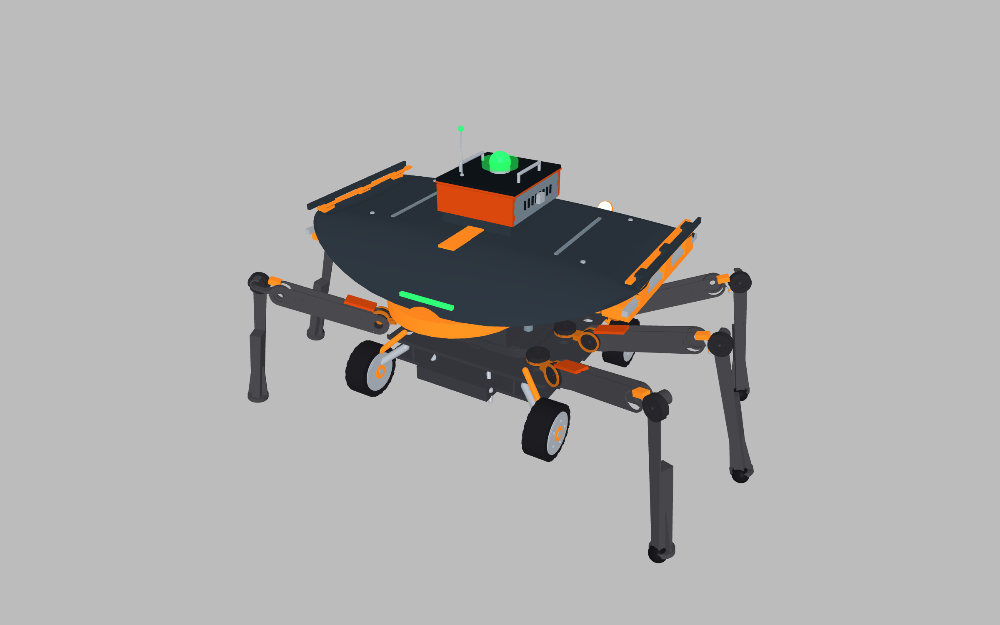
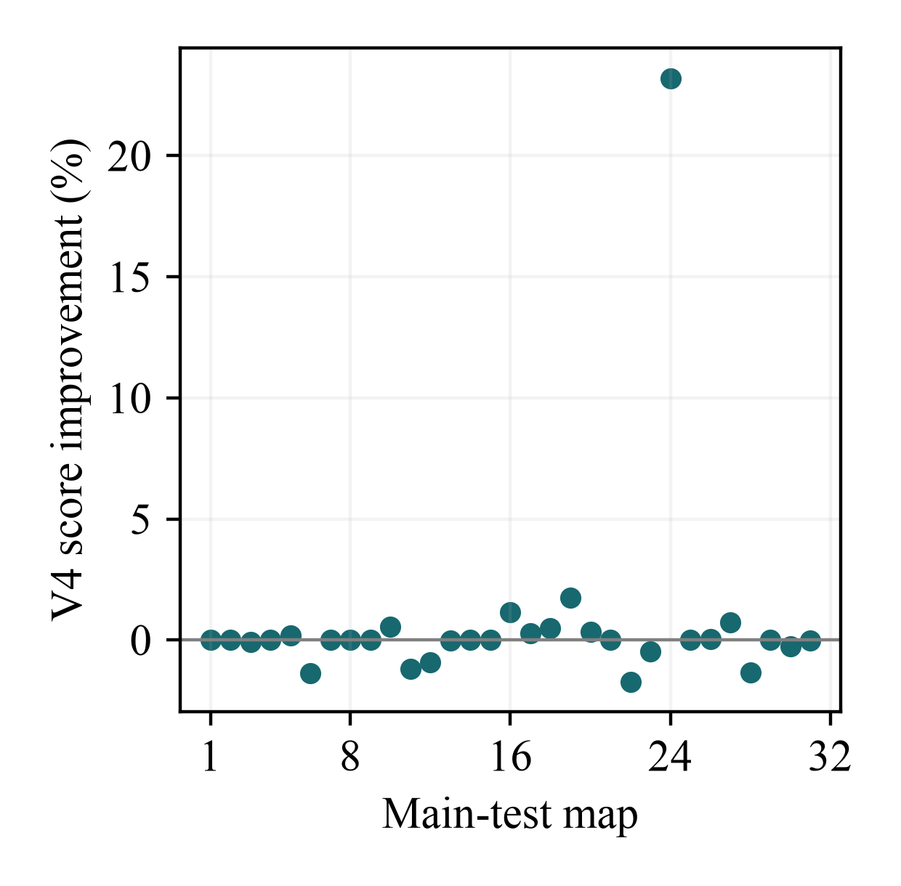
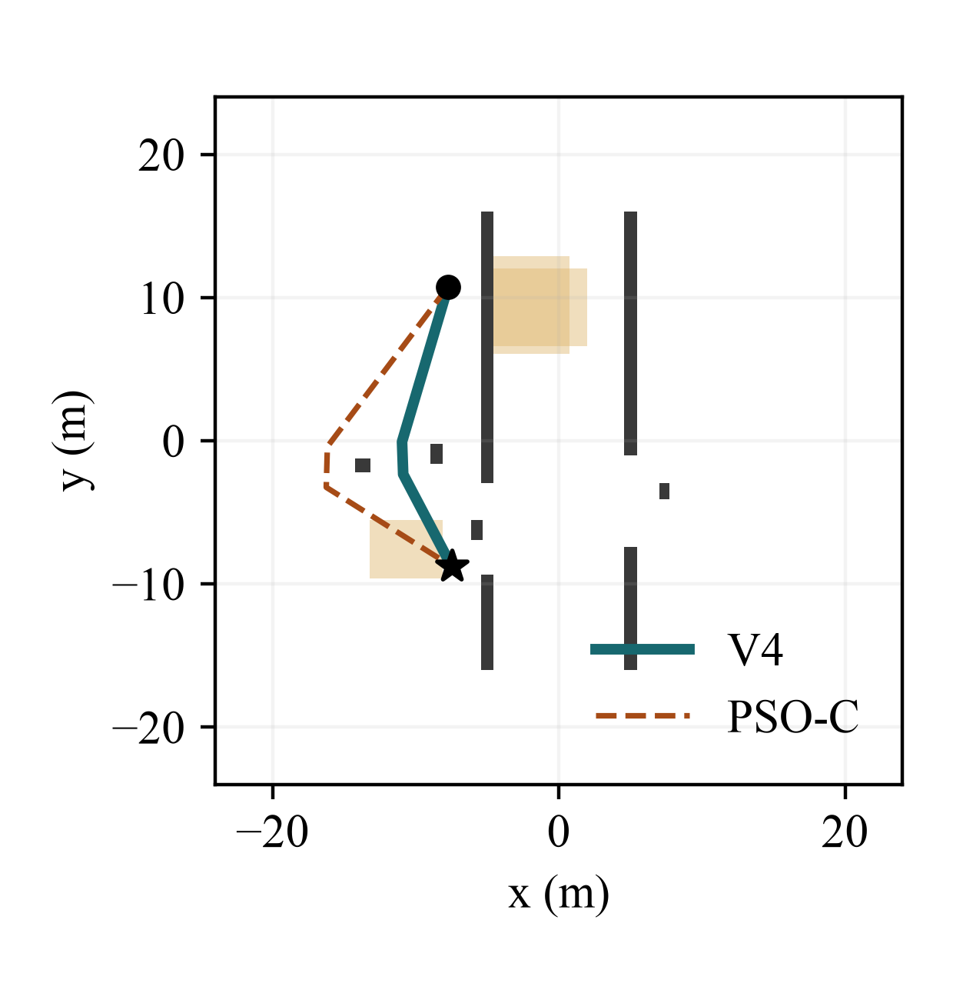

# Constrained Route Planning for a Simulated Hexapod

[Author names and affiliations]
[Corresponding author email]

## Abstract

This study measures the contribution and computational cost of landmark search and final local adjustment in constrained body-route planning for a simulated hexapod. Six configurations share obstacle clearance, deadlines, nominal battery limits and terrain-exposure limits. Eight development maps select settings, and 32 main-test maps provide three repetitions per method, giving 640 planning attempts. The complete planner, V4, accepts 93 of 96 main-test attempts; coordinate-based particle swarm optimization, PSO-C, accepts 94. Removing final adjustment reduces acceptance to 90. Removing landmark search retains 93 and reduces mean search time from 0.376 to 0.196 s, while complete V4 has a 0.924% conditional mean score improvement over that reduced version. Against PSO-C, V4 has a mean paired-map score improvement of 0.690%, a zero median and a descriptive 95% bootstrap interval of [−0.255, 2.312]%, which includes zero. A separate sixteen-execution diagnostic completes four missions with each of full and half-scale body assistance; neither zero-assistance condition completes a mission within 180 s. Assisted executions detect no foot contact under the six-foot detector. The results identify configuration-specific planning trade-offs and assistance dependence. Battery costs are nominal model outputs, without physical or electrical validation.

Keywords: Hexapod; planning; optimization; simulation; reproducibility

## 1 Introduction

A robot route must clear obstacles and meet the limits of its task. A short route can still miss a deadline or leave insufficient battery allowance for returning to a charging station. In the present model, terrain changes the allowed walking speed, turns add time and nominal battery use, and exposure to difficult terrain is limited. Route selection therefore requires both a cost comparison and a separate decision on whether all task limits are satisfied.

In MuJoCo [1], this study asks how landmark search and final local route adjustment affect acceptance, route score and computation when the map, evaluator and task limits remain fixed. The complete planner, V4, combines an initial corridor search, additional connections around obstacles and terrain, and local adjustment of intermediate route points. Its controls include particle swarm and ant-based configurations, a particle swarm optimizer with movable point coordinates, and two versions with a V4 stage removed. The experiment evaluates these implemented configurations; it does not introduce a new swarm update rule or establish a globally optimal planner.

The contribution is a controlled comparison that separates three outcomes: acceptance under hard resource limits, score differences conditional on joint acceptance, and the search work required to obtain those routes. Eight development maps select settings before a 32-map main test with three paired repetitions. The stage-removal comparisons quantify whether additional search changes acceptance or merely improves an already acceptable route. A separate four-map motion diagnostic establishes how the execution model depends on direct body assistance, so that planned route acceptance is distinguished from locomotion validation.

The hexapod application determines the planar body-clearance envelope and the walking speed and turning assumptions. The planner receives the map and pose directly and searches body routes rather than full foot-placement sequences. Its results concern the stated geometric and nominal resource model. This scope permits a reproducible comparison of planning stages without treating modeled battery use or assisted motion as measured physical robot performance.

## 2 Related work

A* searches a graph using accumulated cost and an estimate of the remaining cost [2]. Particle swarm optimization updates solutions from particle motion and the best positions found by particles and the swarm [3]. Ant system guides route construction with pheromone and heuristic information [4]. A visibility graph connects points with obstacle-free straight segments [5]. These established components motivate the initial search, population controls and landmark connections used here. The bounded search retains its best candidate without a global-optimality guarantee.

Resource-constrained routing requires more than minimizing a single path length. Ma combines A* and label setting for multimodal routes with multiple resource and mode-sequence constraints [6]. That transportation formulation establishes relevant constrained-search methodology, while its network and mode-chain problem differs from the present planar robot routes. Here, finite initial-search labels and landmark candidates are followed by continuous point adjustment, with deadline, return-battery and terrain limits checked by one evaluator.

Guo et al. combine particle swarm optimization with control-barrier-function velocity adjustment for mobile robot path planning [7]. Their safety mechanism links planning with velocity control. The present comparison holds the segment-clearance test fixed and measures acceptance and score under the same resource limits; it does not implement or experimentally rank their controller. This distinction matters because changing the collision model, initialization or execution mechanism changes the comparison as well as the optimizer.

Hexapod studies also optimize quantities below the body-route level. Yin et al. optimize swing trajectories, gait timing and gait sequence on LittleStrong [8]. Chen et al. combine terrain features with travel costs, foot placement and gait planning, with simulation and physical experiments [9]. The present study fixes the gait controller, supplies terrain directly and investigates body-route stage removal. Its separate assistance diagnostic does not substitute for the physical and foot-placement evaluations in those studies.

These studies motivate a specific experimental question: within one declared evaluator, what acceptance and score benefit accompanies the extra computation of landmark search and final adjustment? The controls compare complete configurations because their initialization and route representations differ. They are not reproductions of every cited planner. Following the COCO procedure's emphasis on initialization, parameter selection and stopping rules [10], the study reports those choices and counts both route evaluations and geometric queries. The resulting comparison concerns the stated implementations and resource model.

## 3 Robot and planning model

### 3.1 Robot model and body assistance

The robot model has six legs, with three rotating joints per leg. The imported robot description has a total mass of 97.52 kg and a base mass of 35 kg. The assembled MuJoCo model has a total robot mass of 113.32 kg and a base mass of 46 kg. The simulation also includes wheels and a scanner, giving 23 actuators in total. All experiments in this paper use walking mode, while the added mechanisms remain part of the simulated mass.

Figure 1 shows the MuJoCo robot model at walking initialization. The static view illustrates the assembly, including the wheels and scanner, with the surrounding obstacles hidden for clarity. The planning results in Section 6 use the maps and task limits specified in Section 5.

Figure 1. Static view of the simulated hexapod in its walking configuration. The wheels and scanner remain part of the assembly.

The imported robot description assigns leg-joint limits of 60 Nm of effort and 20 rad/s of velocity. These are declared limits in that description. The experiment includes no measurements of a physical motor's torque-speed curve, battery discharge or robot mass. The simulated assembly is the platform evaluated in this paper; the imported mass values are reported to identify the difference between the two descriptions.

MuJoCo advances the physics in steps of 0.004 s. The motion controller runs once every four physics steps, or every 0.016 s. Gravity is 9.81 m/s squared. Gravity compensation is enabled on 18 leg bodies in the standard configuration. This compensation and direct body assistance are separate mechanisms: the former counteracts gravity on the selected bodies, while the latter changes the free body's velocity directly.

Body assistance controls vertical motion and roll/pitch rates once per controller frame. It also changes horizontal velocity and yaw rate at each physics step. At assistance scale 1, the horizontal velocity is set to the requested velocity. At scale 0.5, each correction keeps half of the current velocity and adds half of the requested velocity. This blend is applied four times per frame. At scale 0, the controller leaves these body velocities unchanged by the assistance operation. The scale is a velocity-blending setting, not a specified support force.

The planner receives the robot's position, heading, obstacles and terrain directly from the simulation. It does not estimate these inputs from sensors. The start position, initial heading, destination and charging-station return estimate are identical across methods for each test. The experiment therefore compares decisions made with the same known map. Sensor noise, localization error and map reconstruction are outside the tested input model.

### 3.2 Route geometry

A route P is a sequence of points in the horizontal plane. Its first and last points are the supplied start and destination. Straight segments join consecutive points. The grid used for initial search has 0.25 m spacing and eight possible motion directions. A diagonal move through a blocked grid corner is rejected.

Every returned segment must pass the same clearance test against the planar obstacle shapes. The configured robot radius is 1.82 m, the tracking margin is 0.12 m, and the segment-clearance tolerance is 0.005 m. These values define the planning clearance model. The test checks a route for the robot body; it does not calculate a separate three-dimensional foot trajectory along every segment.

The terrain map contains regions with different walking-speed limits and difficulty values. Terrain difficulty is sampled along each route segment at spacing no greater than 0.125 m. The exposure assigned to a segment is its length multiplied by its mean sampled difficulty. Total exposure R is the sum over all segments. This is a cost defined by the terrain map, not a measured probability of slipping.

### 3.3 Route score and acceptance

The route evaluator calculates four quantities: distance D in metres, predicted destination travel time T in seconds, nominal battery use E in percentage points, and terrain exposure R. The initial heading is π/2 radians. Predicted time includes travel at the terrain-dependent speed limit, heading changes at 1 rad/s, and an acceleration allowance. The speed limits for smooth, mild and higher-grade terrain are 0.75, 0.65 and 0.38 m/s.

Equation (1) combines the four quantities into a score Q. A smaller score is better. The denominators express one score unit as 50 m of distance, 90 s of predicted time, 30 nominal battery percentage points or 80 exposure units. They define the experiment's fixed trade-offs; they are not estimated from robot measurements or fitted to the main-test outcomes.

$$Q(P)=D/50+T/90+E/30+R/80\qquad (1)$$

Acceptance requires the predicted destination time to meet the deadline, exposure to meet the terrain limit, and the required nominal battery allowance to fit the available battery. Equation (2) gives that allowance. The subscript return identifies the nominal battery use of a route from the destination to a charging station. The factor 1.25 and the additional six percentage points are fixed reserve rules.

$$B_{\mathrm{req}}=1.25(E+E_{\mathrm{return}})+6\qquad (2)$$

The battery cost model assigns 0.70 percentage points per walking metre, 0.015 per second, 0.08 per turning radian and a 0.10 start/stop allowance. These coefficients were not fitted to electrical measurements. Distance, travel time and turning also contribute to E, so the four score terms are not independent physical outcomes. Combining them expresses a declared preference for these route properties. The 1.25 multiplier increases the modeled outward-and-return cost by 25%, and the six-point reserve adds a fixed allowance. Neither rule is a statistically calibrated probability of completing a real mission. All comparisons use these same settings; their robustness to different weights or reserves is not established by this experiment. Battery use in this paper means the output of this equation-based model. Mechanical joint work and electrical battery consumption are different quantities, and the route score does not convert one into the other.

The charging station and return route are selected once per test before the planners are compared. Each planner then chooses an outward route using the same return allowance. The destination deadline applies to the outward route. The motion experiment follows both the outward and return routes and adds eight seconds of simulated service after arrival at the station. Its mission distance and elapsed time therefore cover more than the outward quantities D and T.

A route with a lower score is still rejected if any hard limit is exceeded. Candidate ranking first separates routes that meet all limits from routes that do not. For rejected routes, the excess over each limit is divided by that limit, and the positive ratios are added. A lower sum ranks first; excesses of at most 0.00000001 are treated as zero. For accepted routes, lower Q ranks first. This rule allows a search stage to improve acceptance as well as score and prevents a later rejected candidate from replacing an accepted route.

## 4 Planning methods

### 4.1 Complete planner

V4 has three stages. The first stage searches initial corridors while accounting for time, battery and terrain limits. A corridor is an initial route through free space from which later stages construct alternatives. The second stage adds connections through a limited set of points around obstacles and terrain boundaries. The final stage adjusts complete routes by deleting points, projecting points, replacing points by midpoints, and moving point coordinates.

The best-ranked route is kept throughout the search. A proposed route replaces it only when the ranking improves. Every proposed change must pass the common segment-clearance test before its route cost is evaluated. Repeated route geometries reuse their previous evaluations. These rules apply to the shared local-adjustment stage used by the compared planners.

Table 1 specifies V4’s time fractions, landmark limit, local move sizes and initial-search bounds. These settings limit the alternatives considered within a trial.

A graph connection and a complete route evaluation are counted separately. The graph search can reject a line segment before it becomes part of a full route. It also stores alternatives with different headings and resource costs. The local-adjustment stage instead changes a complete sequence of route points. A shared limit on full route evaluations therefore does not imply equal numbers of geometric queries across methods.

Algorithm 1 summarizes the complete V4 procedure. The same evaluator and ranking rule apply at every stage; initialization's evaluated routes count toward the common ceiling.

Algorithm 1. Complete V4 route search.

Input: known geometry and terrain; start, goal and heading; mission limits; fixed return allowance; random seed; two-second and 240-evaluation ceilings.

1. Run the initial resource-aware refiner within 40% of the time allowance. Charge its route evaluations to the common ceiling and retain its returned incumbent.

2. Test the direct start-to-goal connection while budget remains. For each new route, reject invalid or blocked geometry, otherwise evaluate the common metrics and feasibility rank. Reuse cached evaluations for repeated geometry.

3. Gather points from the incumbent, inflated obstacle corners and terrain boundaries. Remove duplicate and blocked points, rank extras by start-to-point plus point-to-goal distance, and retain at most 44 total nodes including endpoints.

4. Build collision-free connections and search heading-aware routes using score, time and battery weights, within the landmark time allocation and expansion bound. Evaluate resulting complete routes with the common rank.

5. Apply final local adjustment to the best route: test point deletion, projection, midpoint replacement and directional moves at 0.75, 0.25 and 0.08 m. Retain only better rankings; stop at the common budget or at most three passes per step size.

Output: the best retained route and its metrics, or the initial search status when no route is retained. An accepted route always ranks ahead of a rejected one.

### 4.2 PSO and ant controls

PSO-P and ACO-P select subsequences of points from initial corridors and apply the shared final local-adjustment stage. Their selected population sizes, update parameters and iteration limits are reported in Table 1.

PSO-C uses continuous coordinates for the internal route points. It begins with the same configured initial corridor search as V4. The longest segments are subdivided until the route has at least six internal points. Existing corners are preserved during subdivision, and the start and destination remain fixed. The number of internal points is fixed during a trial, while their horizontal coordinates can move within the map bounds.

PSO-C applies Gaussian perturbations to internal point coordinates and clips velocities and positions to the specified bounds (Table 1). Proposals that fail clearance are discarded. The initial best route remains available when particle proposals do not improve it, and final adjustment shares the common evaluation ceiling.

PSO-C and PSO-P differ in their coordinate representation and their initial-route procedure. Their comparison measures the combined effect of these implementation choices. It does not isolate a change in representation alone. All reported results apply to the specified settings and route objective.

### 4.3 Removal of planner stages and search limits

V4 noL removes the search through extra points, called landmarks. V4 noP removes final local adjustment, also called polishing. Both versions inherit the selected V4 settings for the stages they retain. In particular, noP removes only the final adjustment stage; it retains processing performed inside the initial refiner. They measure the effect of removing one stage from the tested planner. The reduced versions are not separately retuned on the main-test maps. Table 1 summarizes the selected search settings. Here noL means without landmark search, and noP means without final local adjustment.

Table 1. Selected search settings; noL omits landmark search and noP omits final adjustment.

| Method | Search settings | Final adjustment |
| --- | --- | --- |
| V4 | Initial fraction 0.40; landmark fraction 0.32; 44 nodes; initial beam 6, labels/state 8, candidates 16 | Steps 0.75, 0.25, 0.08 m |
| V4 noL | V4 initial settings; no landmark stage | Same as V4 |
| V4 noP | V4 initial and landmark settings | Omitted |
| PSO-P | 16 particles; 40 iterations/corridor; inertia 0.72; coefficients 1.49; velocity clip 0.25 | Same as V4 |
| ACO-P | 12 ants; 40 iterations/corridor; pheromone/heuristic exponents 1/2; evaporation 0.20; deposit 1 | Same as V4 |
| PSO-C | 12 particles; 40 iterations; inertia 0.65; coefficients 1.4; perturbation and velocity clip 2 m | Last 25% of time; V4 steps |

Every method has a nominal two-second search allowance and a ceiling of 240 evaluated collision-free routes. Evaluations used by initialization count toward that ceiling. Collision checks on rejected proposals are counted as geometric work rather than complete route evaluations. A method can finish below both limits when it exhausts its prescribed operations. PSO-C can also exhaust the evaluation ceiling before its time allowance is used.

The wall timer includes initialization and refinement for the individual method. Shared map preparation is performed separately before the methods run. This includes loading the scene, building the common graph, preparing the return route and calculating common search guidance. Search time therefore measures one part of the planning process. It excludes preparation that all methods share for a given case.

## 5 Experimental design

### 5.1 Maps and task limits

The experiment uses eight development maps with seeds 2130000-2130007 and 32 main-test maps with seeds 2140000-2140031. Map types cycle through open, clutter, rough and corridor. Each type contributes two development maps and eight main-test maps. Every map extends from −24 to 24 m along each horizontal axis.

The four types have 5, 16, 7 and 4 generated obstacles, respectively. Corridor maps also contain two interrupted barriers. The numbers of terrain patches are 1, 2, 4 and 3. Each map defines the obstacles, shallow terrain tiles and regions that set the walking speed and exposure. All six planners receive exactly the same geometry and terrain for a given case.

Start and destination proposals are sampled within [−17, 17] m on both axes, with an initial separation of 12-26 m. They are moved to free grid locations and retained when their final separation is at least 10 m. Deadlines are drawn from 45, 70, 110 and 160 s. Available nominal battery levels are 45, 65, 85 and 100%, and exposure limits are 10, 20 and 40. The charging-station return estimate is fixed before comparing the methods.

The planning battery coefficients remain fixed for every map. Thus different battery allowances change the available resource limit, rather than the amount of nominal battery use assigned to a metre or a turn. The experiment varies map geometry and task constraints. It does not test a calibrated range of physical battery characteristics.

### 5.2 Parameter selection and repeated tests

Each of the four base methods is tested with two parameter profiles on the development maps. Selection first favors the profile with more accepted attempts. If acceptance is equal, the profile with the lower mean score among accepted attempts is selected. Exact ties retain the default. The default profile is selected for every base method. Both reduced V4 versions inherit that selection.

The alternative PSO-P profile uses 24 particles, inertia 0.55 and cognitive/social coefficients 1.7/1.3. The alternative ACO-P profile uses 18 ants, heuristic exponent 3 and evaporation 0.35. The alternative PSO-C profile uses 20 particles, 60 iterations, inertia 0.75, cognitive/social coefficients 1.6 and a 4 m perturbation and velocity bound. The alternative V4 profile uses initial-search and extra-point fractions of 0.55 and 0.25, 60 points, and local move sizes of 0.50, 0.15 and 0.05 m. Other settings retain the corresponding defaults.

The development phase contains 64 planning attempts: eight maps, four methods and two profiles. The main test contains 576 attempts: 32 maps, six methods and three paired repetitions. Each method therefore has 96 main-test attempts, and the complete experiment has 640. The maps, parameter-selection rule and primary analysis were set before the main-test results. There was no external preregistration. All scheduled main-test attempts are included in the acceptance counts.

The three repetitions within a map share the same task and geometry. They provide repeated algorithm runs, rather than three independent maps. Score differences are averaged within a map before summarizing across maps. This gives equal weight to each paired map, including cases where the number of jointly accepted repetitions differs.

### 5.3 Score comparison and statistical analysis

Score comparisons use only attempts for which both V4 and the comparison method accept a route. Acceptance by only one method and rejection by both methods are counted separately. Equation (3) defines the relative score difference for a paired attempt. Q_c is the comparison method's score and Q_v is V4's score. A positive difference means V4 has the lower score; a negative difference means the comparison method has the lower score. Absolute score differences of at most 0.00000001 are counted as ties.

$$\delta=100(Q_c-Q_v)/Q_c\qquad (3)$$

The reported mean and median use the map averages of these paired differences. Descriptive 95% percentile bootstrap intervals use 5,000 resamples of maps, with random seed 41104, following the resampling principle in [11]. Repetitions stay grouped within their map. The intervals are conditional on acceptance by both methods and are not adjusted for the five comparisons. A 0.5% difference is used only as a descriptive reference for counting larger improvements.

The family breakdown, computation summary, map-by-map display and omission analysis were calculated after the main test. They describe the existing results without changing the selected settings or the main-test sample. In the omission analysis, one paired map is left out at a time and the mean is recalculated. The resulting means show how strongly an individual map affects the average. Every map remains in the primary analysis.

The tests run under Python 3.10.12, MuJoCo 3.9.0, NumPy 2.2.6 and SciPy 1.15.3 on Linux. The processor is an Intel Core i5-7600 at 3.50 GHz with four logical processors. The desktop also runs concurrent workloads. Reported wall times are observations from that environment, rather than measurements of exclusive processor use or real-time deployment latency.

### 5.4 Motion tests and contact measurements

The motion experiment uses four previously evaluated maps, one each of open, clutter, rough and corridor, with seeds 1670000-1670003. It follows the V4 route from the first repetition in each map and then the fixed return route to a charging station. The outward route lengths are 21.36, 22.30, 23.45 and 19.78 m. Initial nominal battery levels are 45, 85, 45 and 100%, respectively. These routes are selected by map order and are separate from the 32 main planning maps.

Each mission is run under four conditions: full body assistance with gravity compensation, half-scale assistance with compensation, zero assistance with compensation, and zero assistance without compensation. The route follower and 180 s maximum simulated duration are the same in every condition. Completion means reaching the destination and returning to the station. An unfinished mission reaches the time limit. Completed mission time includes eight seconds of modeled station service.

Gravity compensation is checked after the locomotion controller is initialized. The compensation-free condition sets all body compensation values to zero at that point. Four preliminary runs in which initialization restored compensation are excluded from that condition and are repeated after verified removal. The final comparison contains four missions under each of four conditions, giving 16 executions. These previously evaluated routes form a diagnostic of the execution model, rather than a new set of unseen locomotion tests.

Foot contact is sampled at every 0.004 s physics step. A foot counts as in contact when one of the six foot geometries touches a geometry outside the robot and their reported distance is at most 0.002 m. Mean contact feet is the average number of detected feet per sample. The no-contact percentage is the fraction of samples with zero detected foot contacts. This detector concerns the six feet; contacts involving other robot parts are not counted as foot contacts.

Body tilt is calculated from the body's orientation. Assisted runs directly correct roll and pitch, so low tilt in those runs measures the assisted controller's behavior. Positive actuator work integrates the positive part of actuator force times actuator velocity. It excludes work associated with the direct body-velocity corrections. These measurements describe simulated motion and joint activity under the specified assistance condition.

## 6 Results

### 6.1 Accepted routes and paired scores

All 640 planning attempts finish without a recorded trial error, and development selects the default profile for every base method. Table 2 reports all main-test acceptance counts and mean search times. V4, PSO-P, ACO-P and V4 noL each accept 93/96 attempts; PSO-C accepts 94/96 and V4 noP accepts 90/96. Every rejected main-test attempt fails a resource requirement.

Table 2. Accepted main-test routes and mean search time.

| Method | Accepted / 96 | Mean time (s) |
| --- | --- | --- |
| V4 | 93 | 0.376 |
| PSO-P | 93 | 0.223 |
| ACO-P | 93 | 0.335 |
| PSO-C | 94 | 0.731 |
| V4 noL | 93 | 0.196 |
| V4 noP | 90 | 0.329 |

Against PSO-C, V4 has 33 lower-score paired accepted attempts, 27 ties and 33 higher-score attempts. PSO-C alone accepts one attempt; V4 alone accepts none, and both reject two. The paired-map mean difference is 0.690%, the median is zero and the descriptive 95% interval is [−0.255, 2.312]%. The interval includes zero.

Table 3 reports means and intervals for all five comparisons. The PSO-P and ACO-P comparisons both have zero medians. Against V4 noL, complete V4 has 27 lower-score attempts, 57 ties and nine higher-score attempts. Against V4 noP, it has 57 lower-score attempts, 33 ties and no higher-score attempts, together with three attempts accepted only by complete V4. Thus the score and acceptance effects of each removed stage remain separate outcomes.

Table 3. Paired score differences favoring V4; n is the number of paired maps.

| Control | n | Mean (%) | 95% interval (%) |
| --- | --- | --- | --- |
| PSO-P | 31 | 0.929 | [0.027, 2.523] |
| ACO-P | 31 | 0.921 | [0.029, 2.507] |
| PSO-C | 31 | 0.690 | [-0.255, 2.312] |
| V4 noL | 31 | 0.924 | [0.036, 2.513] |
| V4 noP | 30 | 0.794 | [0.443, 1.209] |

Table 2 includes all 96 attempts per method. Table 3 uses only jointly accepted attempts, averaged within each map before the map-level analysis. The comparison against V4 noP includes 30 paired maps; the others include 31. A conditional score comparison does not replace the acceptance result for the full sample.

### 6.2 Map types and computation

All resource rejections occur in corridor maps. Open, clutter and rough maps each give 24/24 accepted attempts for every method. Corridor acceptance is 21/24 for V4, PSO-P, ACO-P and V4 noL, 22/24 for PSO-C and 18/24 for V4 noP. Each map type contributes eight maps and three repetitions. These counts locate both PSO-C’s extra acceptance and the three acceptances lost after removing final adjustment.

Table 4 reports search work across all 96 attempts per method. PSO-C reaches the 240-route evaluation ceiling on 84/96 attempts; none of the other methods reaches it. Median route-evaluation counts are 33 for V4 and 21 after landmark removal. Median geometric-clearance checks are 1,033 for V4, 2,142.5 for PSO-C and 146.5 for V4 noL. Shared map preparation takes a median of 0.715 s and a maximum of 0.895 s, outside the individual search timers. A route evaluation computes full-route metrics, whereas a clearance query can reject a segment before a complete route is evaluated.

Table 4. Search work over 96 attempts; evaluations count complete collision-free routes.

| Method | Median s | Max s | Median evals | At 240 |
| --- | --- | --- | --- | --- |
| V4 | 0.368 | 0.776 | 33 | 0 |
| PSO-P | 0.199 | 0.635 | 46 | 0 |
| ACO-P | 0.296 | 0.895 | 32.5 | 0 |
| PSO-C | 0.724 | 1.203 | 240 | 84 |
| V4 noL | 0.166 | 0.586 | 21 | 0 |
| V4 noP | 0.338 | 0.634 | 5 | 0 |

All searches finish below the nominal two-second allowance; the largest recorded search time is 1.203 s for PSO-C. Equal ceilings do not imply equal work: PSO-C exhausts the route-evaluation allowance on most attempts, whereas the other configurations stop at lower counts. These times exclude shared preparation and reflect the desktop workload described in Section 5.3.

### 6.3 Variation across maps

Figure 2 shows all 31 paired-map effects against PSO-C, ranging from −1.718% to 23.202%. Map 24 supplies the largest positive effect. Leaving it out changes the remaining-map mean from 0.690% to −0.060%. For the noP comparison, the means obtained by leaving out one map at a time remain positive, ranging from 0.682% to 0.822%. These are post-hoc influence summaries of the unchanged main-test sample.

Figure 2. V4 score difference against PSO-C on every paired map, averaged over jointly accepted repetitions. Positive values favor V4. All points remain in the primary mean.

The positive effect on map 24 remains in the primary mean and bootstrap interval. Its influence explains the positive mean alongside a zero median and equally many lower- and higher-score pairs against PSO-C. The omission calculation measures concentration of the result; it supplies no basis for excluding the map from the principal analysis.

### 6.4 Selected route comparison

Map 24 is a corridor map on which both methods accept all three repetitions. V4 returns the same route in every repetition, with distance 20.803 m and score 1.310; PSO-C’s corresponding mean values are 27.135 m and 1.706. V4’s mean predicted time, nominal battery cost and exposure are 32.959 s, 15.446 points and 1.012, compared with 42.584 s, 20.066 points and 1.665 for PSO-C.

V4 has lower values of all four score components in every paired repetition. Figure 3 shows repetition zero: PSO-C takes a wider detour to the west. This explains the score difference for that returned route without identifying a unique internal cause in the optimizer.

Figure 3. Routes on corridor map 24, repetition 0. The circle and star mark start and destination; black blocks are obstacles and amber regions are terrain. This case is selected post hoc for its largest positive paired-map effect.

The example is selected after the main test because it has the largest positive paired-map effect against PSO-C. It explains one point in Figure 2 rather than estimating a typical improvement. The full distribution and the zero median remain the basis for interpreting the comparison.

### 6.5 Assistance diagnostic

Full and half-scale assistance each complete 4/4 missions. Both zero-assistance conditions complete 0/4, with all unfinished missions timing out at 180 s. Table 5 combines completion and foot-contact measurements for the sixteen valid executions. GC denotes leg-body gravity compensation. Each contact range summarizes four missions; mean feet is the average detected foot count per physics sample, and no-contact percentage is the fraction of samples with zero detected foot contacts. Contacts involving other robot parts are outside this detector.

Table 5. Completion and foot-contact ranges across four missions per condition.

| Condition | Done / 4 | Mean feet | No-contact (%) |
| --- | --- | --- | --- |
| Full + GC | 4 | 0.000 | 100.00 |
| Half + GC | 4 | 0.000 | 100.00 |
| Zero + GC | 0 | 0.421–0.422 | 83.00–83.05 |
| Zero, no GC | 0 | 4.009–4.017 | 0.02 |

Full-assistance mission distances are 34.71–42.83 m, with elapsed times of 62.85–89.63 s; half-scale values are 34.75–42.91 m and 62.83–89.66 s. Completed times include eight seconds of station service. At zero assistance, displacement by the timeout is 0.324–0.326 m with compensation and 0.376–0.381 m without it. Assisted runs have maximum tilt below 0.410 degrees while roll and pitch are directly corrected.

All eight assisted executions finish while the six-foot detector reports zero foot contact. This demonstrates route following by the assisted body model, without establishing propulsion by foot-ground forces. With zero assistance, the model moves a short distance but completes no mission within 180 s, both with leg gravity compensation and after its verified removal. The outcomes describe these four routes, rather than a general hardware failure rate.

## 7 Discussion

Final local adjustment improves acceptance and paired scores more consistently than landmark search in this campaign. The lost acceptances after its removal occur in corridor maps; removing landmarks preserves acceptance while lowering recorded computation. Incumbent retention is designed to accept only improved rankings, so non-worsening within the final stage is an intended property. The empirical contribution is the measured benefit and cost under the stated limits. Separately timed stage-removal runs do not establish a formal guarantee across runs. An initial-route-only baseline and controlled budget sweep would further separate initialization quality from later-stage value; neither comparison is included here.

V4 does not establish a mean score advantage over PSO-C. Its interval includes zero, its median is zero and PSO-C accepts one additional attempt. Map 24 supplies much of the positive mean. The positive mean effects against PSO-P and ACO-P also have zero medians and concern their implemented settings. Differences in initialization and point representation prevent attributing the outcome to representation alone. The five unadjusted intervals remain descriptive rather than corrected confirmatory tests.

Every method accepts all non-corridor tasks, so acceptance differences concern the corridor cases in the four specified map families. The three repetitions characterize algorithm variation within each map; they do not increase the number of independent main-test maps beyond 32. Harder unseen geometries would require a separately declared evaluation. Likewise, weight and reserve sensitivity are not tested. The fixed score combines overlapping route preferences, since nominal battery use includes distance and time. Joint actuator work excludes body assistance, and no electrical measurements establish physical energy savings. Search times characterize the recorded shared-desktop environment and unequal work counts, rather than real-time deployment latency.

The motion diagnostic establishes dependence on direct assistance for these four missions. Assistance corrects body velocities and roll/pitch rates, so completed routes and low tilt do not independently validate a walking gait. The six-foot contact result further limits that interpretation. The known map and pose, differing source and assembled masses, and absence of physical motor, battery, terrain and contact measurements define the simulation scope. Physical walking and sensor-based navigation remain unevaluated.

## 8 Conclusions

Under the fixed 32-map main-test protocol, final local adjustment increases acceptance from 90 to 93 of 96 attempts. Landmark search preserves that acceptance count and adds search time for a 0.924% paired mean score benefit over its removal. The two stage-removal comparisons therefore identify different acceptance, score and computation trade-offs. V4 does not establish a mean score advantage over PSO-C: its 0.690% paired-map mean has a zero median and a descriptive interval spanning zero, while PSO-C accepts one additional attempt.

The sixteen valid motion executions provide a separate diagnostic: the four tested missions complete with full or half-scale assistance and time out at zero assistance, with or without verified leg gravity compensation. The assisted executions report no foot contacts under the defined detector. The study thus distinguishes acceptance of a constrained body route from validation of unassisted physical locomotion. Its reported costs and trade-offs apply to the declared simulation model and fixed objective.

## References

[1] E. Todorov, T. Erez, and Y. Tassa, "MuJoCo: A physics engine for model-based control," in Proc. IEEE/RSJ Int. Conf. Intell. Robots Syst., 2012, pp. 5026–5033, doi: 10.1109/IROS.2012.6386109.

[2] P. E. Hart, N. J. Nilsson, and B. Raphael, "A formal basis for the heuristic determination of minimum cost paths," IEEE Trans. Syst. Sci. Cybern., vol. 4, no. 2, pp. 100–107, 1968, doi: 10.1109/TSSC.1968.300136.

[3] J. Kennedy and R. Eberhart, "Particle swarm optimization," in Proc. ICNN Int. Conf. Neural Netw., vol. 4, 1995, pp. 1942–1948, doi: 10.1109/ICNN.1995.488968.

[4] M. Dorigo, V. Maniezzo, and A. Colorni, "Ant system: Optimization by a colony of cooperating agents," IEEE Trans. Syst., Man, Cybern. B, vol. 26, no. 1, pp. 29–41, 1996, doi: 10.1109/3477.484436.

[5] T. Lozano-Pérez and M. A. Wesley, "An algorithm for planning collision-free paths among polyhedral obstacles," Commun. ACM, vol. 22, no. 10, pp. 560–570, 1979, doi: 10.1145/359156.359164.

[6] T.-Y. Ma, "An A* label-setting algorithm for multimodal resource constrained shortest path problem," Procedia Soc. Behav. Sci., vol. 111, pp. 330-339, 2014, doi: 10.1016/j.sbspro.2014.01.066.

[7] B. Guo, Y. Sun, and Y. Chen, "Safe path planning of mobile robot based on improved particle swarm optimization," Trans. Inst. Meas. Control, vol. 47, no. 9, pp. 1715-1724, 2025, doi: 10.1177/01423312241264860.

[8] Y. Yin, F. Gao, Q. Sun, Y. Zhao, and Y. Xiao, "Smart Gait: A gait optimization framework for hexapod robots," Chin. J. Mech. Eng., vol. 37, Art. no. 15, 2024, doi: 10.1186/s10033-024-01000-0.

[9] C. Chen, J. Lin, B. You, J. Li, and B. Gao, "Hexapod robot motion planning investigation under the influence of multi-dimensional terrain features," Front. Neurorobot., vol. 19, Art. no. 1605938, 2025, doi: 10.3389/fnbot.2025.1605938.

[10] COCO Project, "COCO: The experimental procedure," 2016. [Online]. Available: https://numbbo.github.io/coco-doc/experimental-setup/. Accessed: Nov. 4, 2026.

[11] B. Efron, "Bootstrap methods: Another look at the jackknife," Ann. Statist., vol. 7, no. 1, pp. 1-26, 1979, doi: 10.1214/aos/1176344552.

